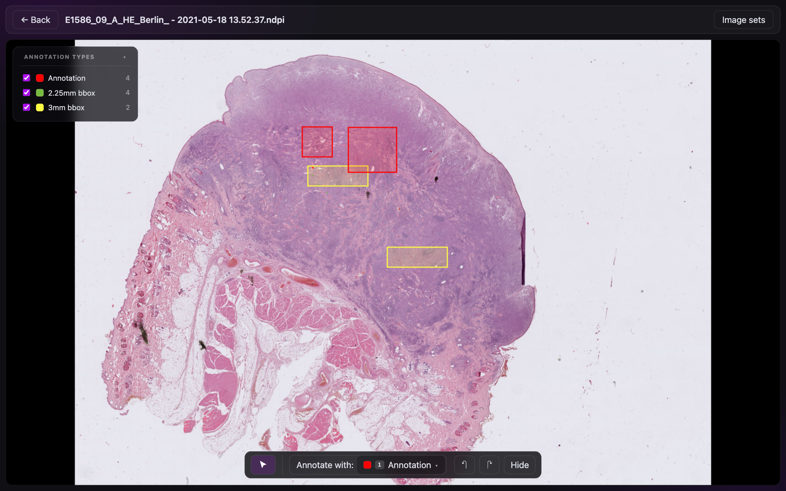
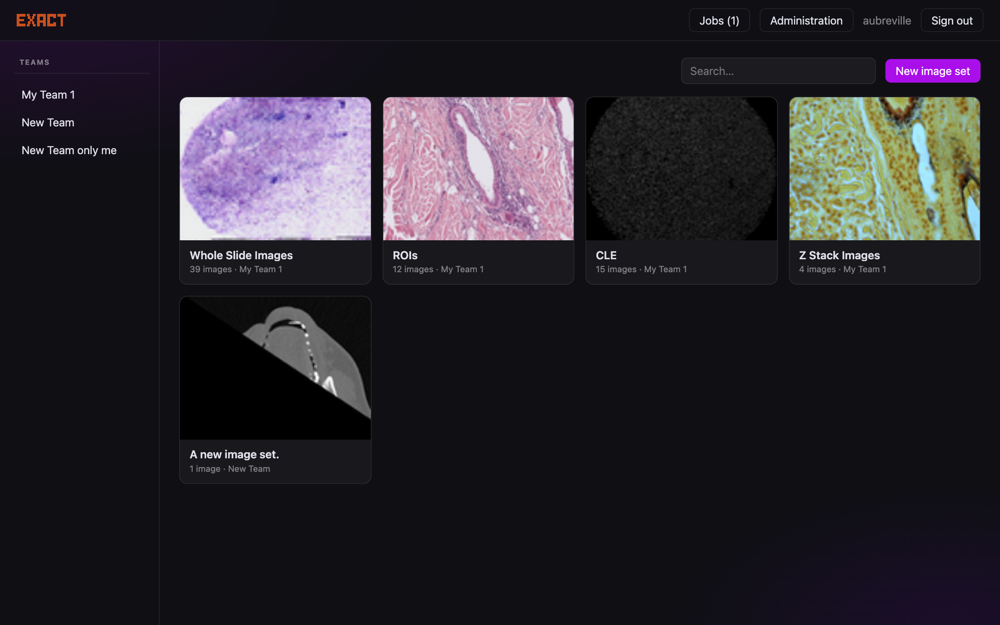
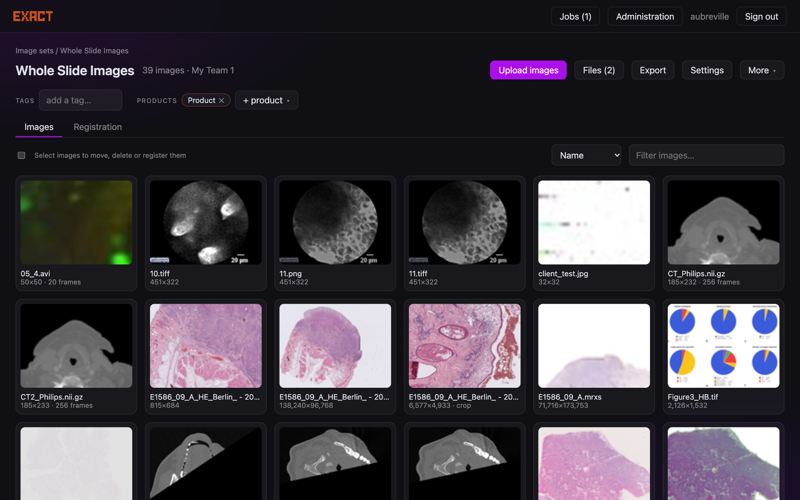
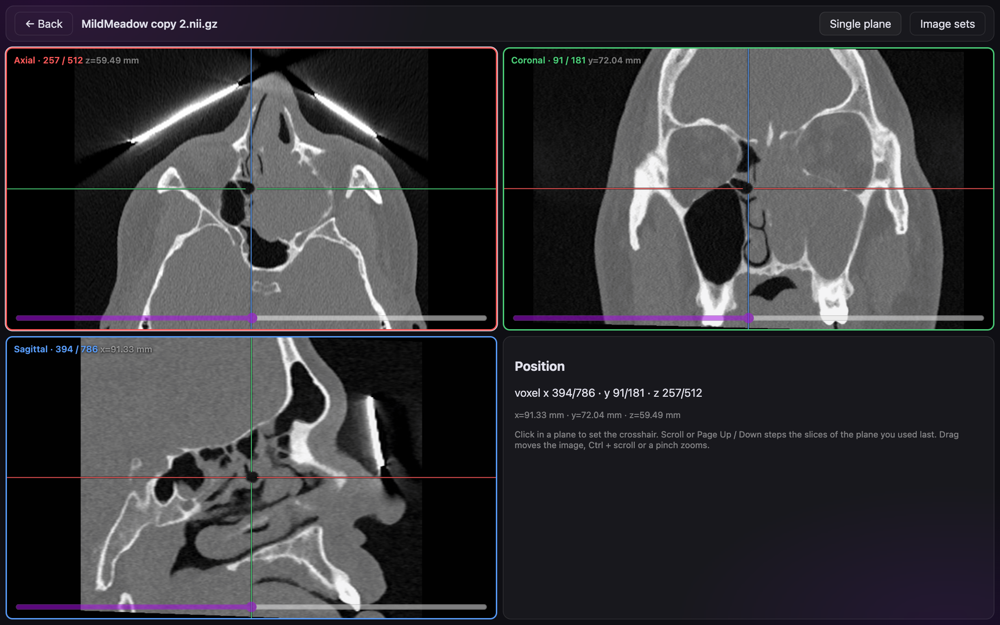

# EXACT-Rust

A Rust port of [EXACT](https://github.com/DeepMicroscopy/Exact) (annotation tool for microscopy images): one binary plus
PostgreSQL, a new React front end, and the same REST interface for [exact-sync](https://github.com/DeepMicroscopy/EXACT-Sync)
and ML workers. **Work in progress.**

The server runs against the *existing EXACT (Django) database*: no schema change except additive tables, so Django can
be rolled back at any time. The plan, decisions, measurements and the status of every phase are in [PLAN.md](PLAN.md).



<p>


</p>
<p>

</p>

Documentation: `docs/` (published with GitHub Pages: user guide, shortcuts, administration, API, installation).

## Status
| Area | State |
|---|---|
| Auth: password (all Django hash formats), tokens, sessions, passkeys (server side), invitations, impersonation (API) | done |
| REST: `/api/v1` byte-compatible with EXACT incl. writes and the legacy endpoints of exact-sync; `/api/v2` for the new UI | done |
| Slides: OpenSlide formats, TIFF/BigTIFF, OME-TIFF z-stacks, NIfTI/DICOM (three-plane view), MKT, MP4/AVI, CZI/VSI (helper) | done; iSyntax dropped |
| Pyramid repair, level registration, image registration (manual and by worker plugins), job queue | done |
| Front end: image sets, uploads, viewer with annotation tools and polygon operations, crops, export, registration, jobs, administration | done |
| Deployment: Dockerfile, compose, systemd units, runbook ([docs/DEPLOY.md](docs/DEPLOY.md)) | beta on a copy of production in progress |

## Layout
- `crates/exact-core` config, errors - `exact-db` queries and additive migrations - `exact-auth` hashes, tokens, WebAuthn
- `crates/exact-wsi` slide readers, DeepZoom tiles, TIFF reader/writer, pyramid repair and registration
- `crates/exact-api` HTTP layer (`compat/` = v1/legacy for exact-sync, `v2/`, slides, repair) - `exact-server`, `exact-cli`
- `frontend/` React + TypeScript + Vite; `helpers/slideio_helper.py` reads CZI/VSI/DICOM through slideio
- `tests/conformance` replays recorded responses of the reference EXACT against this server; `tests/perf`, `reference/` (reference Django setup)

## Run
```
make ui                       # build the front end (frontend/dist, served by the binary)
cargo build -p exact-server   # needs libopenslide, ffmpeg (libav*) and libclang to build
SQL_DATABASE=exact SQL_USER=... SQL_PASSWORD=... IMAGE_PATH=/path/to/images EXACT_LISTEN=127.0.0.1:8002 target/debug/exact-server
```
Configuration uses EXACT's environment variable names (`SQL_*`, `IMAGE_PATH`, `FIDO_SERVER_ID`, ...); `EXACT_CACHE_DIR` holds
thumbnails, `SLIDEIO_PYTHON` / `SLIDEIO_HELPER` select the slideio helper, `EXACT_STATIC_DIR` the front end.

## Tests
`make verify` restores a scratch database from a backup of an EXACT database (`backups/`, **not in the repository**: create it
with `pg_dump -Fc` of a local EXACT, see `scripts/restore-backup.sh`), starts the reference Django and this server and runs
unit tests, conformance (Django vs. recorded responses vs. Rust), exact-sync, the v2 suites and a schema-sync check
(`make schema-sync`). `make e2e` runs the browser smoke test (system Chrome); `make e2e-repair` the repair flow on a scratch copy.

## License
MIT, like EXACT.
