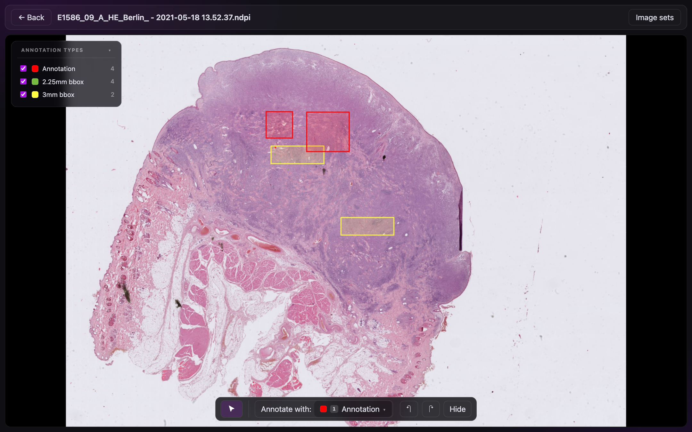
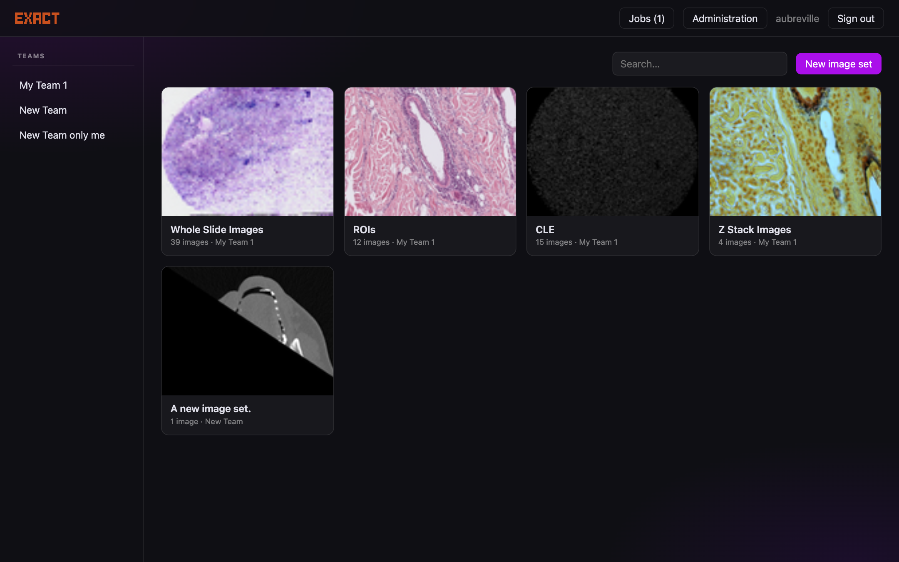
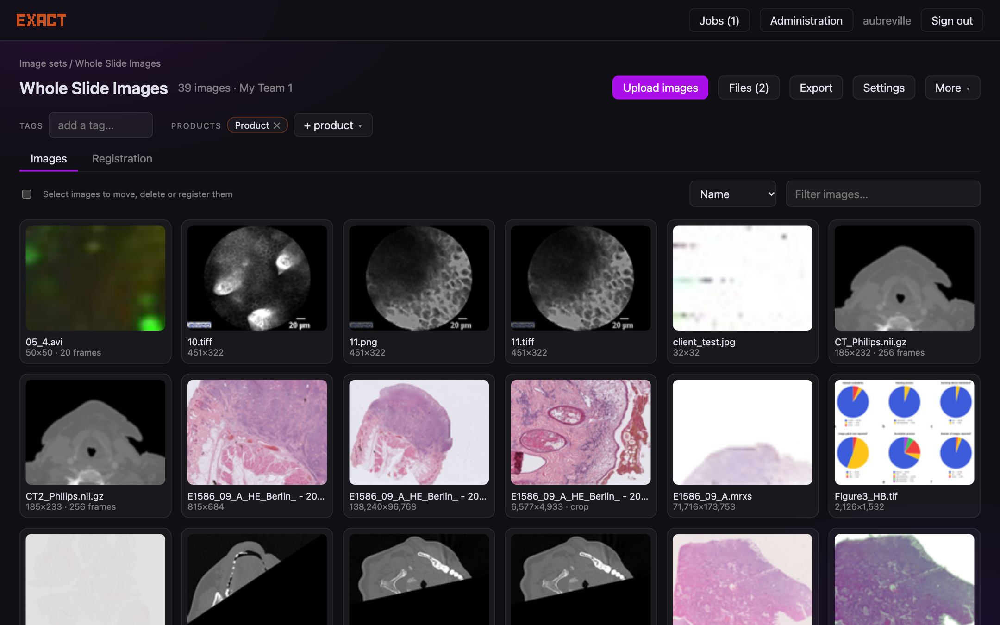
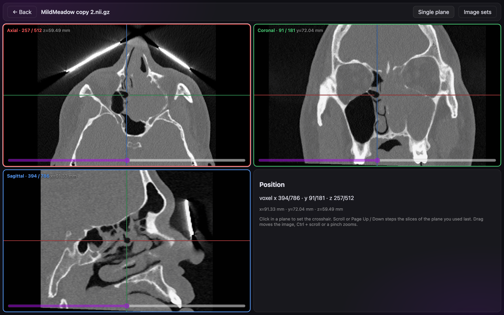
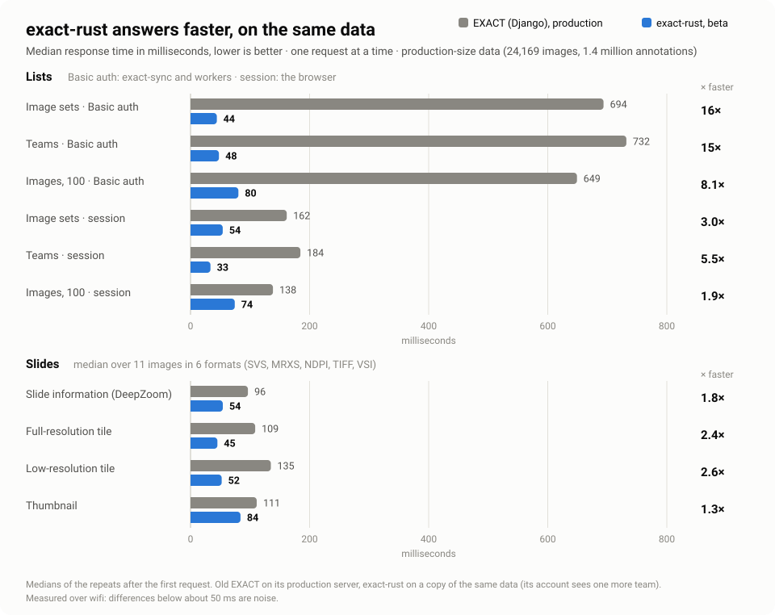

# EXACT-Rust

A Rust port of [EXACT](https://github.com/DeepMicroscopy/Exact) (annotation tool for microscopy images): one binary plus
PostgreSQL, a new React front end, and the same REST interface for [exact-sync](https://github.com/DeepMicroscopy/EXACT-Sync)
and ML workers. **Work in progress.**

You can **start from scratch** (no earlier EXACT needed, see [Get started](#get-started)) or run it on an **existing EXACT (Django)
database**: no schema change except additive tables, so Django can be rolled back at any time. The plan, decisions, measurements and the
status of every phase are in [PLAN.md](PLAN.md).



<p>


</p>
<p>

</p>

Documentation: `docs/` (published with GitHub Pages: user guide, shortcuts, administration, API, installation).

## Get started

| Do you already run EXACT (the Django version)? | |
|---|---|
| **No**, I want to start using EXACT-Rust | follow the six steps below (about 30 minutes, most of it waiting) |
| **Yes**, I want to move my EXACT with its users and data | read [Moving from EXACT](docs/from-exact.md): try it on a copy first, then run both side by side |

### A new installation in six steps
You need a computer with Windows, macOS or Linux, about 10 GB of free disk and an internet connection. No programming, no database
and no graphics card are needed: everything runs inside Docker.

**1. Install Docker Desktop** from [docker.com/products/docker-desktop](https://www.docker.com/products/docker-desktop/) and start it
(on Windows it may ask to install WSL and to restart). On Linux install Docker Engine instead. Docker has to be running whenever
EXACT-Rust should be reachable.

**2. Download EXACT-Rust:** on this page click the green **Code** button → **Download ZIP**, and unpack it, for example into
your Documents folder. (With git: `git clone https://github.com/DeepMicroscopy/Exact-Rust.git`.)

**3. Open a terminal in that folder** (the one that contains `README.md` and the folder `deploy`):
* Windows 11: right-click the folder → **Open in Terminal** (Windows 10: Shift + right-click → *Open PowerShell window here*)
* macOS: right-click the folder → **Services** → **New Terminal at Folder** (or open Terminal, type `cd ` and drag the folder into its window, then press Enter)
* Linux: open a terminal and `cd` into the folder

**4. Create your settings file** and open it in a text editor; type the line for your system into the terminal and press Enter:

| | |
|---|---|
| Windows | `copy deploy\quickstart.env.example deploy\.env` and then `notepad deploy\.env` |
| macOS | `cp deploy/quickstart.env.example deploy/.env` and then `open -e deploy/.env` |
| Linux | `cp deploy/quickstart.env.example deploy/.env` and then `nano deploy/.env` |

In the file, replace both `change-me` with passwords of your own: `SQL_PASSWORD` (for the database; you never type it again, make it
long) and `EXACT_ADMIN_PASSWORD` (to log in). `EXACT_ADMIN_USER` is your login name, `EXACT_ADMIN_TEAM` the name of your first team.
Save and close the file.

**5. Start EXACT-Rust:**
```
docker compose -f deploy/quickstart.yml up -d --build
```
The first time this takes 20 to 40 minutes (it builds everything); you can follow it in the terminal. It is done when the prompt
comes back; give the server another minute to prepare the database on its very first start. Later starts take seconds.

**6. Open [http://localhost:8002](http://localhost:8002)** in your browser and log in with `EXACT_ADMIN_USER` and
`EXACT_ADMIN_PASSWORD`. Change the password under your user name (top right) → **Preferences**.

Then [create your first image set and upload slides](docs/howto-team.md); invite colleagues under **Administration → Users**.

**Good to know**
* EXACT-Rust starts by itself whenever Docker Desktop is running (also after a restart of the computer).
* Stop it: `docker compose -f deploy/quickstart.yml stop` (start again with `... start`).
* Update: download the new version, copy your `deploy/.env` into it and run the command of step 5 again in the new folder.
  Your slides, annotations and accounts are kept (they live in Docker, not in the downloaded folder).
* Something does not work? The [troubleshooting table](docs/quickstart.md#when-something-goes-wrong) lists the usual messages and
  their fix; `docker compose -f deploy/quickstart.yml logs server` shows what the server says.
* More options (another port, slides in a folder of your own, access from other computers with https, the registration worker):
  [Start from scratch](docs/quickstart.md).

## Speed
<p align="center">
<picture>
<source media="(prefers-color-scheme: dark)" srcset="docs/assets/performance-dark.svg">

</picture>
</p>

<details><summary>The numbers</summary>

Median response time in milliseconds (lower is better), one request at a time, the first request of each series left out:

| Request | EXACT (Django), production | exact-rust, beta | faster |
|---|---:|---:|---:|
| Image sets · Basic auth | 694 | 44 | 16× |
| Teams · Basic auth | 732 | 48 | 15× |
| Images, 100 · Basic auth | 649 | 80 | 8.1× |
| Image sets · session | 162 | 54 | 3.0× |
| Teams · session | 184 | 33 | 5.5× |
| Images, 100 · session | 138 | 74 | 1.9× |
| Slide information (DeepZoom) | 96 | 54 | 1.8× |
| Full-resolution tile | 109 | 45 | 2.4× |
| Low-resolution tile | 135 | 52 | 2.6× |
| Thumbnail | 111 | 84 | 1.3× |

</details>

**How this was measured** (`tests/perf/compare_servers.py`; the picture is drawn by `tests/perf/render_chart.py`): the same read-only requests against the old EXACT on its production server and
exact-rust on a copy of the same data (24,169 images, 1.4 million annotations), one request at a time, the two servers alternating, with an ordinary member account on each. *Basic auth*
is what exact-sync and workers use (Django checks the password on every request, which is most of its time there); *session* is what the browser uses after logging in. The slide requests are the DeepZoom descriptor,
a tile and the thumbnail of 11 images in 6 formats. Caveats: measured over home wifi, so differences below about 50 ms are noise; the two accounts differ by one team; production serves real users meanwhile.
Not in the picture: loading all 45,000 annotations of one image at once (the call exact-sync uses; Django had not answered after three minutes) and many parallel clients: both are in the script and need a quiet server.

## Status
| Area | State |
|---|---|
| Auth: password (all Django hash formats), tokens, sessions, passkeys (server side), invitations, impersonation (API) | done |
| REST: `/api/v1` byte-compatible with EXACT incl. writes and the legacy endpoints of exact-sync; `/api/v2` for the new UI | done |
| Slides: OpenSlide formats, TIFF/BigTIFF, OME-TIFF z-stacks, NIfTI/DICOM (three-plane view), MKT, MP4/AVI, CZI/VSI (helper) | done; iSyntax dropped |
| Pyramid repair, level registration, image registration (manual and by worker plugins), job queue | done |
| Front end: image sets, uploads, viewer with annotation tools and polygon operations, crops, export, registration, jobs, administration | done |
| Deployment: Dockerfile, compose, systemd units, runbook ([docs/DEPLOY.md](docs/DEPLOY.md)); [new installations without Django](docs/quickstart.md) | beta on a copy of production in progress |

## Layout
- `crates/exact-core` config, errors - `exact-db` queries and additive migrations - `exact-auth` hashes, tokens, WebAuthn
- `crates/exact-wsi` slide readers, DeepZoom tiles, TIFF reader/writer, pyramid repair and registration
- `crates/exact-api` HTTP layer (`compat/` = v1/legacy for exact-sync, `v2/`, slides, repair) - `exact-server`, `exact-cli`
- `frontend/` React + TypeScript + Vite; `helpers/slideio_helper.py` reads CZI/VSI/DICOM through slideio
- `tests/conformance` replays recorded responses of the reference EXACT against this server; `tests/perf`, `reference/` (reference Django setup)

## Run from source (development)
To install and use EXACT-Rust see [Get started](#get-started); this is for working on the code.
```
make ui                       # build the front end (frontend/dist, served by the binary)
cargo build -p exact-server -p exact-cli   # needs libopenslide, ffmpeg (libav*) and libclang to build
export SQL_DATABASE=exact SQL_USER=... SQL_PASSWORD=... IMAGE_PATH=/path/to/images EXACT_LISTEN=127.0.0.1:8002
target/debug/exact-cli migrate --confirm-db exact      # an empty database gets EXACT's tables first: no Django needed for a new instance
target/debug/exact-cli create-superuser --username admin --team mylab --confirm-db exact   # new instance only; password on stdin
target/debug/exact-server
```
Configuration uses EXACT's environment variable names (`SQL_*`, `IMAGE_PATH`, `FIDO_SERVER_ID`, ...); `EXACT_CACHE_DIR` holds
thumbnails, `SLIDEIO_PYTHON` / `SLIDEIO_HELPER` select the slideio helper, `EXACT_STATIC_DIR` the front end.

## Tests
`make verify` restores a scratch database from a backup of an EXACT database (`backups/`, **not in the repository**: create it
with `pg_dump -Fc` of a local EXACT, see `scripts/restore-backup.sh`), starts the reference Django and this server and runs
unit tests, conformance (Django vs. recorded responses vs. Rust), exact-sync, the v2 suites and a schema-sync check
(`make schema-sync`). `make e2e` runs the browser smoke test (system Chrome); `make e2e-repair` the repair flow on a scratch copy.

## License
MIT, like EXACT.
