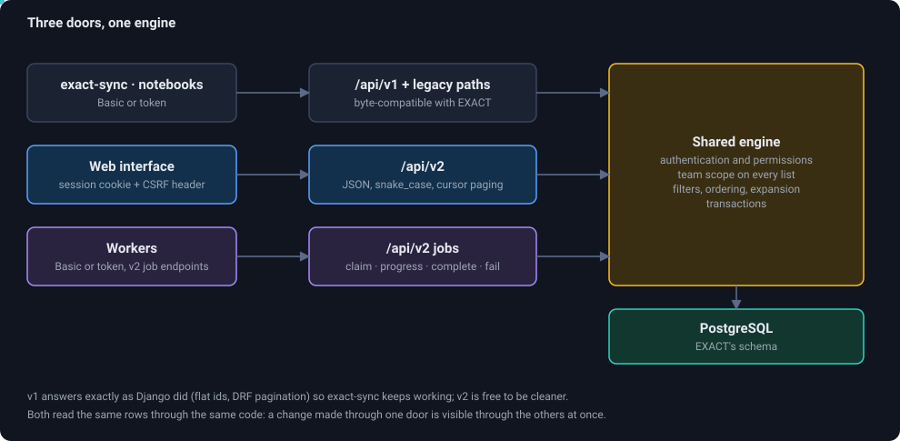

# API

EXACT-Rust has two public interfaces on the same data. This page shows both with examples that were run against a server (the responses are real, shortened where they are long).

<figure class="diagram"><figcaption>Three doors, one engine: a change made through one is visible through the others at once.</figcaption></figure>

| | `/api/v1` and the legacy paths | `/api/v2` |
|---|---|---|
| For | exact-sync, QueueRunner, existing notebooks | the web interface, new scripts, workers |
| Shape | exactly what the Django EXACT answers (flat ids, DRF pagination with `count`/`next`/`results`) | JSON, `snake_case`, cursor paging (`items` + `next_cursor`), typed errors |
| Promise | byte-compatible for everything that existed | free to improve |
| Auth | Basic or token | session cookie + CSRF header, Basic or token |

## Authentication

```bash
export EXACT_PASSWORD=...   # in your shell, never in a file that is committed

# HTTP Basic (every request): fine for scripts
curl -u "alice:$EXACT_PASSWORD" https://exact.example.org/api/v2/auth/me

# A personal access token (made in Preferences -> Access tokens, or see "Access tokens" below)
curl -H "Authorization: Bearer <token>" https://exact.example.org/api/v2/auth/me

# A session, as the web interface does it
curl -c jar.txt -X POST https://exact.example.org/api/v2/auth/login \
     -H 'content-type: application/json' -d "{\"username\":\"alice\",\"password\":\"$EXACT_PASSWORD\"}"
```
```json
{"csrf_token":"ivxWpF8imVqUdIfpN3C97zWNZqpLT3EhZi9aN6yf",
 "user":{"id":1,"is_staff":true,"is_superuser":true,"read_only":false,"username":"alice"}}
```

With a session cookie, every request that **changes** something needs the token in a header:

```bash
CSRF=$(curl -s -b jar.txt https://exact.example.org/api/v2/auth/me | jq -r .csrf_token)
curl -b jar.txt -H "x-csrf-token: $CSRF" -H 'content-type: application/json' -X POST ...
```

Basic and token requests need no CSRF header. All examples below leave out the host and the credentials: `H=(-b jar.txt -H "x-csrf-token: $CSRF" -H 'content-type: application/json')` stands for them.

## Conventions of v2

* **Resources** are plural, without trailing slash: `/api/v2/image-sets`, `/api/v2/image-sets/{id}`.
* **Paging** is by cursor, ordered by id: `?limit=50` and `?cursor=<next_cursor of the last page>`.
* **Fields:** `?fields=id,name` keeps only those, `?omit=images` drops one, `?expand=` expands references.
* **Filters** are the field names: `/api/v2/annotations?image=2`.
* **Times** are RFC 3339 in UTC (`2026-11-07T20:26:44.879002Z`).
* **Errors** carry a `detail` and, for validation, the fields:

```
HTTP/1.1 400 Bad Request
{"detail":"Validation failed.","errors":{"annotation_type":["This field is required."]}}

HTTP/1.1 404 Not Found
{"detail":"Not found."}

HTTP/1.1 403 Forbidden
{"detail":"Authentication credentials were not provided."}
```

`409 Conflict` means somebody changed the object meanwhile (see conditional edits below); `202 Accepted` means a job was queued.

### Listing

```bash
curl -b jar.txt "https://exact.example.org/api/v2/annotation-types?limit=2&fields=id,name"
```
```json
{"items":[{"id":1,"name":"Annotation"},{"id":2,"name":"TestSegmentation"}],"next_cursor":"aWQ6Mg"}
```
Pass `next_cursor` as `cursor` to get the next page; the last page has no `next_cursor`.

## The resources

| Area | Endpoints |
|---|---|
| Authentication | `POST /auth/login`, `/auth/logout`, `GET /auth/me`, passkeys under `/auth/passkey*`, `/auth/passkeys` |
| Account | `/me/account`, `/me/email`, `/me/password`, `/me/preferences`, `/me/statistics`, `/me/tokens` (access tokens) |
| Catalogue | `GET /image-sets`, `/images`, `/annotation-types`, `/products`, `/teams`, `/annotations`, `/verifications`, `/action-logs`, and the generic `/{resource}` lists |
| Teams | `POST /teams`, `PATCH`/`DELETE /teams/{id}`, `PUT`/`DELETE /teams/{id}/members/{user}`, `GET /teams/{id}/statistics`, `/invitations` |
| Image sets | `POST /image-sets`, `PATCH`/`DELETE /image-sets/{id}`, `/image-sets/{id}/images` (upload), `/tags`, `/products/{pid}`, `/settings`, `/exports`, `/export-formats`, `/auxiliary-files`, `/annotation-counts` |
| Images | `GET /images/{id}`, `DELETE`, `/images/{id}/crop`, `/move`, `/rename`, `/repair`, `/metadata`, `/download`, `/related`, `/screening`, `/register` |
| Annotations | `POST /annotations`, `PATCH`/`DELETE /annotations/{id}`, `/annotations/{id}/verify`, `/annotations/{id}/media-files` |
| Registration | `POST /registrations/manual`, `GET`/`DELETE /registrations/{id}`, `/registrations/{id}/convert`, `/inverse`, `/points`, `GET /registration-plugins` |
| Volumes | `/images/{id}/voxels`, `/render-volume`, `/auto-segment`, `/segmentation/{annotation}/...`, `/linked-volumes/...` |
| Jobs and workers | `GET /jobs`, `POST /jobs/claim`, `/jobs/{kind}/{id}/restart`, `/plugins/register`, `/plugin-jobs/{id}/progress\|complete\|fail`, `/registration-jobs/...`, `/segmentation-jobs/...`, `/segmenters/register` |
| Administration | `/admin/users`, `/admin/permissions`, `/admin/roles`, `/admin/plugins`, `/admin/log`, `/admin/users/{id}/impersonate`, `/health` |

## Examples: working with a team

### Create a team (the creator becomes its admin)
```bash
curl "${H[@]}" -X POST /api/v2/teams -d '{"name":"Docs Demo Team"}'
```
```json
{"id":4,"image_sets":[],"members":[1],"memberships":[26],"name":"Docs Demo Team","product_set":[]}
```

### Add a member, or promote one
```bash
curl "${H[@]}" -X PUT /api/v2/teams/4/members/3 -d '{"is_admin":false}'
```
```json
{"is_admin":false,"team":4,"user":3}
```

### Invite somebody who has no account yet
```bash
curl "${H[@]}" -X POST /api/v2/invitations -d '{"team_ids":[4],"note":"Anna, pathology"}'
```
```json
{"id":2,"purpose":"invite","status":"pending","team_ids":[4],"note":"Anna, pathology",
 "expires_at":"2026-11-14T20:37:05.140329+00:00","path":"/invite/inv_S3mgeouu0GOM0u3TjEnP4m7hWKENON1Uc1hijaBd",
 "token":"inv_S3mgeouu0GOM0u3TjEnP4m7hWKENON1Uc1hijaBd"}
```
Hand the link `https://<server>/invite/<token>` to the person (there is no e-mail).

### Product, annotation type, image set
```bash
curl "${H[@]}" -X POST /api/v2/products -d '{"name":"Mitosis study","team":4}'
curl "${H[@]}" -X POST /api/v2/annotation-types -d '{"name":"Mitotic figure","product":5,"vector_type":6,
     "color_code":"#ff3355","default_width":50,"default_height":50,"size_unit":"px","sort_order":1}'
curl "${H[@]}" -X POST /api/v2/image-sets -d '{"name":"Study images","team":4,"products":[5]}'
```
```json
{"collaboration_type":0,"creator":1,"id":35,"images":[],"name":"Study images",
 "path":"exact_rust_test_4_35","product_set":[5],"set_tags":[],"team":4}
```

`vector_type` is `1` box · `2` point · `3` line · `4` polyline · `5` polygon · `6` fixed-size box · `7` global (a label for the whole image) · `8` segmentation mask.
`size_unit` is `px`, `um` or `mm`.

**Groups of segmentation types (v2 only).** `"seg_group": "organs"` in the body of `POST` / `PATCH /api/v2/annotation-types` puts a segmentation type into a group (`null` or `""` takes it out; up to 50 characters). The masks of the types of one product with the same group name exclude each other on volumes: the 3D operations (`/segmentation/{annotation}/ops`, `labels`, `undo`, `redo`) take every voxel they add from the other masks of the group on that image, and the answer lists the masks that changed as `"changed_others": [annotation ids]`. `GET /api/v2/products/{id}/annotation-types` shows `seg_group`, and `GET /api/v2/segmentation-groups` lists `[{"annotation_type", "product", "group"}]` for the types of your teams that are in a group.

### Upload images
```bash
curl -b jar.txt -H "x-csrf-token: $CSRF" -F "files=@slide1.svs" -F "files=@slide2.tiff" \
     /api/v2/image-sets/35/images
```
```json
{"items":[{"id":190,"name":"docs-demo.png","size":1880,"type":"image"}]}
```
Any number of files per request. A ZIP is unpacked (an archive with a `.mrxs`, `.vms` or `.vsi` makes only those files images); documents (`pdf`, `docx`, `xlsx`, `csv`, ...) become *auxiliary files*; `.nrrd` becomes a segmentation file. See [file formats](file-formats).

### Access tokens

A token lets a script or exact-sync use the API as you without your password. Make one in **Preferences → Access tokens**, or through the API with your password or a signed-in session (a token itself cannot make tokens, and neither can an administrator who is impersonating you):
```bash
curl -u "alice:$EXACT_PASSWORD" -X POST https://exact.example.org/api/v2/me/tokens -H 'content-type: application/json' \
     -d '{"name":"nightly registration","expires_in_days":90,"scopes":["jobs"],"teams":[3]}'
```
```json
{"id":17,"name":"nightly registration","prefix":"Qm3xT0pLw9aB","token":"pat_Qm3xT0pLw9aB.<43 characters>","read_only":false,"scopes":["jobs"],"teams":[3],
 "created_at":"2026-11-11T08:02:11+00:00","expires_at":"2027-02-09T08:02:11+00:00","last_used_at":null,"revoked_at":null,"active":true}
```
**The `token` is in this answer only.** The server keeps just a hash of it, so a lost token is replaced, not recovered. `expires_in_days` (1 to 3650; leave it out for no expiry), `read_only` (the token may only look: every write is refused with 403), `scopes` and `teams` (ids of teams you belong to; the token then sees only their data; empty means all your teams) are optional.

**Scopes** limit what a token may do beyond looking (every `GET` always works). Without `scopes` a token is not limited:

| Scope | Allows |
|---|---|
| `jobs` | queue, restart and cancel analyses, registrations and segmentations (`POST /images/{id}/analyze`, `/register`, `/auto-segment`, `/registrations/manual`, `/jobs/{kind}/{id}/restart`, `DELETE /jobs/{kind}/{id}`) |
| `annotate` | create, change, verify and delete annotations and their files, edit segmentations (`/annotations`, `/segmentation/…`, `/api/v1/annotations/annotations/`, `/annotations/api/…`) |
| `images` | upload, rename, move, crop and delete images, create and change image sets, their tags, products, settings and documents |

A token with a scope list is refused every other write with `403 {"detail":"This token is limited and may not do this."}`, in particular everything that manages accounts, teams, annotation types, products, plugins and workers (a worker that claims jobs uses its own account, not a limited token). `scopes` cannot be combined with `read_only` (which is the narrowest). The answers show `"scopes": null` for a token that is not limited. A token that only queues jobs, for example, is what a nightly script or a pipeline should hold: if it leaks, nobody can read or change anything beyond what the script needed, and it can be revoked without touching anything else. A token that has no business reading your data either should belong to an account of its own, in a team that holds only what it needs.
`GET /api/v2/me/tokens` lists your tokens with `last_used_at`, `expires_at`, `revoked_at` and `active`. `DELETE /api/v2/me/tokens/{id}` **revokes** an active token at once; deleting a revoked or expired one removes it from the list. Site administrators can list the tokens of any account with `GET /api/v2/admin/tokens?user={id}` and revoke them with `DELETE /api/v2/admin/tokens/{id}`; they never see a secret. Tokens made by the old EXACT (Django) are the same thing and appear in the list. **Scopes are kept in a table of this server's own, so EXACT (Django) does not know them:** while a database is also used by the old EXACT, a token's scopes only limit it on this server, and a token that has scopes is not limited when it is presented to Django.

## Examples: annotations

### Create
```bash
curl "${H[@]}" -X POST /api/v2/annotations \
     -d '{"image":2,"annotation_type":1,"vector":{"x1":100,"y1":100,"x2":180,"y2":160}}'
```
```json
{"id":209,"image":2,"annotation_type":1,"vector":{"x1":100,"x2":180,"y1":100,"y2":160},
 "unique_identifier":"ad74c390-b6b6-4e30-a544-7046db04cdd9","user":1,"last_editor":1,
 "time":"2026-11-07T20:26:44.879002Z","last_edit_time":"2026-11-07T20:26:44.879002Z",
 "blurred":false,"concealed":false,"deleted":false,"verified_by_user":false,"generated":false}
```
Coordinates are pixels of the full-resolution image (level 0). The vector is validated against the type (a box needs `x2 - x1 >= 1`, a polygon at least three points, ...). Sending the same `unique_identifier` twice answers `200` with the existing annotation, so a client can retry safely.

### Edit, but not over somebody else's edit
```bash
curl "${H[@]}" -X PATCH /api/v2/annotations/210 \
     -d '{"vector":{"x1":10,"y1":10,"x2":60,"y2":60},"expected_last_edit_time":"2020-01-01T00:00:00Z"}'
```
```
HTTP/1.1 409 Conflict
{"detail": "...", "current": { ...the annotation as it is now... }}
```
Without `expected_last_edit_time` the edit is unconditional. With it, the server refuses when somebody else edited meanwhile and returns the current annotation so the client can merge.

### Verify, delete, undo the delete
```bash
curl "${H[@]}" -X POST   /api/v2/annotations/209/verify -d '{"verified":true}'
curl "${H[@]}" -X DELETE /api/v2/annotations/209                  # 204: a soft delete
curl "${H[@]}" -X PATCH  /api/v2/annotations/209 -d '{"deleted":false}'   # undo
curl "${H[@]}" -X DELETE "/api/v2/annotations/209?hard=true"      # really remove the row
```
Writing an annotation does not verify it; verification is a separate act.

### Read
```bash
curl -b jar.txt "/api/v2/annotations?image=2&limit=1&fields=id,annotation_type,vector"
```
```json
{"items":[{"annotation_type":1,"id":193,"vector":{"x1":10,"x2":60,"y1":20,"y2":90}}],"next_cursor":"aWQ6MTkz"}
```

### A snapshot centred on a point
```bash
curl -u alice:"$EXACT_PASSWORD" -o snap.png \
  https://exact.example.org/images/image/centered_snapshot/2/5000/3200/2048/2048/
```
`GET /images/image/centered_snapshot/{image_id}/{cx}/{cy}/{w}/{h}/` answers the region of the slide at **full resolution** (level 0, the image's default frame) centred on the pixel (`cx`, `cy`), **exactly `w` × `h` pixels**. Where the region lies outside the slide (or the slide has no data) the pixels are white. The corner is `cx - w/2`, `cy - h/2` (integer division), as in the Django EXACT, which has the same path.
The answer is `image/png`; `?format=jpeg` gives `image/jpeg` (quality 90). Authentication is Basic or a token (`Authorization: Bearer ...`), as everywhere in the API, and the image must belong to one of your teams (404 otherwise). The sides may be 1 to 8192 pixels, at most 16 million pixels in all (400 otherwise). A 2048 × 2048 snapshot takes well under a second on a local file.

## Examples: registration

How to use it is in the [registration HOWTO](howto-registration); this is the wire format.

### Queue an automatic registration
```bash
curl "${H[@]}" -X POST /api/v2/images/15/register -d '{"target_image":16}'
```
```
HTTP/1.1 202 Accepted
{"id":221,"source_image":15,"target_image":16,"plugin":3,"status":"queued","registration":null,
 "created_at":"2026-11-07T20:35:07.788722Z","created_by":1,"worker":null,"error":null,"params":{}}
```
Optional body fields: `plugin` (a registration plugin id, see `GET /api/v2/registration-plugins`), the plugin's parameters by name (`mode`, `thumbnail_size`, ...), and `create_inverse_registration`. A job that is already open for the pair is reused.

### Queue a registration with DeeperHistReg and wait for it
Find the plugin first (the default one comes first; DeeperHistReg appears once a worker with the package has announced itself), then queue the job with the plugin's parameters by name:
```bash
curl "${H[@]}" /api/v2/registration-plugins            # [{"id":7,"name":"DeeperHistReg",...,"parameters":[...]}, ...]
curl "${H[@]}" -X POST /api/v2/images/15/register -d '{
  "target_image": 16, "plugin": 7,
  "mode": "deformable", "transform_type": "rigid",
  "thumbnail_size": 4096, "registration_size": 2048,
  "device": "auto", "sift": true, "superglue": true, "angle_step": 60,
  "create_inverse_registration": true}'
```
```
HTTP/1.1 202 Accepted
{"id":230,"source_image":15,"target_image":16,"plugin":7,"status":"queued","registration":null,"error":null,
 "params":{"mode":"deformable","transform_type":"rigid","thumbnail_size":4096,"registration_size":2048,...}}
```
All parameters are optional (defaults: `affine`, `rigid`, 4096, 2048, `auto`, SIFT and SuperGlue on, 60°); at least one of `sift` and `superglue` must be on. A worker running `helpers/queue_worker.py` (with `pip install deeperhistreg`) claims the job. Poll it until it leaves `queued` / `running`; a finished job names its registration, which you can then use as in the examples below:
```bash
until [ "$(curl -s "${H[@]}" /api/v2/registration-jobs/230 | jq -r .status)" != "queued" ] ; do sleep 5; done   # then "running" -> "done" / "failed"
curl "${H[@]}" /api/v2/registration-jobs/230           # {"status":"done","registration":87,...}  or  "error":"CUDA out of memory..."
curl "${H[@]}" "/api/v2/registrations/87/convert?vector=%7B%22x1%22%3A1500%2C%22y1%22%3A1500%7D"
```
With *deformable* the server converts points through the stored deformation field, not just the matrix. In Python with `requests`:
```python
s = requests.Session(); s.auth = ("alice", password)           # or headers={"Authorization": f"Bearer {token}"}
job = s.post(f"{host}/api/v2/images/15/register", json={"target_image": 16, "plugin": 7, "mode": "affine"}).json()
while (job := s.get(f"{host}/api/v2/registration-jobs/{job['id']}").json())["status"] in ("queued", "running"):
    time.sleep(5)
assert job["status"] == "done", job["error"]
```

### Register by points
```bash
curl "${H[@]}" -X POST /api/v2/registrations/manual -d '{"source_image":15,"target_image":16,
  "points":[{"source":[1000,1000],"target":[1100,1050]},
            {"source":[3000,1000],"target":[3100,1050]},
            {"source":[1000,4000],"target":[1100,4050]}]}'
```
```json
{"id":86,"source_image":15,"target_image":16,"registration_error":0.0,
 "transformation_matrix":{"t_00":1.0,"t_01":0.0,"t_02":100.0,"t_10":0.0,"t_11":1.0,"t_12":50.0,"t_20":0.0,"t_21":0.0,"t_22":1.0},
 "inv_matrix":{"t_00":1.0,"t_01":0.0,"t_02":-100.0,"t_10":-0.0,"t_11":1.0,"t_12":-50.0,"t_20":0.0,"t_21":0.0,"t_22":1.0}}
```
One pair gives a shift, two a similarity (scale, rotation, shift), three or more the least-squares affine map. `registration_error` is the RMS distance of the mapped source points from the target points, in target pixels.

### Carry a vector from one image to the other
```bash
curl -b jar.txt "/api/v2/registrations/86/convert?vector=%7B%22x1%22%3A1500%2C%22y1%22%3A1500%2C%22x2%22%3A1600%2C%22y2%22%3A1560%7D"
```
```json
{"x1":1600.0,"x2":1700.0,"y1":1550.0,"y2":1610.0}
```
The vector may have any number of points (`x1,y1,x2,y2,x3,...`). Registrations made by a quad-tree plugin convert piecewise through the stored tree; a plain matrix converts natively. `POST /registrations/{id}/inverse` creates the registration of target onto source.

## Examples: jobs and workers

A worker is a program that logs in with an account (`processing.add_plugin`, `processing.change_pluginjob`, and for registration `images.change_imageregistration`), announces what it can do and polls for jobs. The [plugin page](plugins) explains the roles; this is the protocol.

### Announce a plugin
```bash
curl "${H[@]}" -X POST /api/v2/plugins/register -d '{"name":"Docs demo detector","author":"docs","package":"docs.demo",
  "plugin_type":1,"parameters_schema":[{"name":"threshold","type":"float","default":0.5,"label":"Threshold","min":0,"max":1,"step":0.05}]}'
```
```json
{"id":191,"name":"Docs demo detector","package":"docs.demo","plugin_type":1,"created":true,
 "parameters_schema":[{"name":"threshold","type":"float","default":0.5,"label":"Threshold","min":0,"max":1,"step":0.05}]}
```
`plugin_type` is `1` for image analysis and `2` for registration. Announcing the same package again updates the plugin (`"created": false`).

### Claim a job (one request, atomic)
```bash
curl "${H[@]}" -X POST /api/v2/jobs/claim -d '{"worker":"gpu-1","kinds":["plugin"],"plugin":191}'
```
```
200 {"kind":"plugin","job":{"id":222,"image":2,"plugin":191,"attached_worker":"gpu-1","processing_complete":0.0,
      "image_path":"/data/images/exact_1_1/slide.svs",
      "annotation_types":[{"id":1,"name":"Annotation","vector_type":1}, ...], ...}}
204 nothing is waiting
```
`kinds` are the kinds the worker can do (`registration`, `plugin`); `plugins` (a list, registration) or `plugin` (one id) limits the plugins. A registration job carries `source_path`, `target_path` and `params` instead of `image_path`.
Only jobs of images in the caller's teams are offered.

### Report progress, finish, or fail
```bash
curl "${H[@]}" -X POST /api/v2/plugin-jobs/222/progress -d '{"worker":"gpu-1","progress":40}'          # 204
curl "${H[@]}" -X POST /api/v2/plugin-jobs/222/complete -d '{"worker":"gpu-1","annotation_type":1,
     "name":"Detections","default_threshold":0.5,
     "detections":[{"vector":{"x1":100,"y1":100,"x2":140,"y2":140},"score":0.93}]}'
curl "${H[@]}" -X POST /api/v2/plugin-jobs/222/fail -d '{"worker":"gpu-1","error":"Error: out of memory","detail":"traceback ..."}'
```
```json
{"result":70,"entry":67,"annotations":1}
```
`complete` stores the result, its entry and **all detections in one transaction** (a job never keeps half a result) and finishes the job at 100 %. Every detection's vector is **validated against the annotation type**, as for annotations made by hand; one invalid vector refuses the whole result with `400 detections[17]: the vector is not valid for the annotation type "..." (a box needs exactly x1, y1, x2, y2 with x2 > x1 and y2 > y1)`. `409` if the job is not attached to that worker, or is finished already. Registration jobs use `/registration-jobs/{id}/complete` with `transformation_matrix`, `registration_error` and `runtime` (JSON, or multipart with the pickled quad tree as `file`).

### Analysis from the viewer (v2)

What the *Analysis* panel uses:

```bash
curl -b jar.txt /api/v2/images/2/analysis
```
```json
{"results":[{"id":88,"plugin":{"id":196,"name":"Shot detector"},"job":null,"completed_time":"2026-11-07T22:02:14Z",
             "entries":[{"id":85,"name":"Mitotic Figures","default_threshold":0.5,"count":400}]}],
 "plugins":[{"id":196,"name":"Shot detector","package":"org.example.shot","author":"","served":true,
             "parameters_schema":[{"name":"threshold","type":"float","default":0.5,"label":"Threshold"}],
             "job":{"id":230,"status":"done","progress":100.0,"error":null}}]}
```
`plugins` are the analysis plugins that name no product or share one with the image's set; `served` says whether a worker asked for them lately; `job` is the latest job of the plugin on this image.

```bash
curl "${H[@]}" -X POST /api/v2/images/2/analyze -d '{"plugin": 196, "params": {"threshold": 0.7}}'      # 202 {"id": 231, "status": "queued", "reused": false}
curl -b jar.txt /api/v2/plugin-result-entries/85/detections
```
```json
{"id":85,"name":"Mitotic Figures","default_threshold":0.5,"truncated":false,
 "types":{"1":{"name":"Annotation","color":"#ff0000"}},
 "boxes":[[2153,880,2326,1052,0.93,1], ...],"polygons":[]}
```
`params` are checked against the plugin's schema (unknown names are refused) and reach the worker as `job["params"]`. An open job of the plugin on the image is returned (200, `"reused": true`) instead of a second one. `boxes` are `[x1, y1, x2, y2, score, annotation type]`, `polygons` `{"t", "s", "p": [x1, y1, x2, y2, ...]}`; an entry with more than 300,000 detections says `"truncated": true`.

### Look at the queue
```bash
curl -b jar.txt "/api/v2/jobs?status=queued&limit=1"
```
```json
{"items":[{"id":221,"kind":"registration","plugin_name":"DeeperHistReg","image":15,"images":[15,16],
           "status":"queued","progress":null,"worker":null,"error":null,"created_at":"2026-11-07T20:35:07.788722Z"}],
 "workers":[]}
```
`workers` lists the workers that asked for work lately (name, kinds, how many seconds ago); the Jobs page shows it, so users see whether anybody is there to do their job.

## `/api/v1` for exact-sync

The REST interface of the Django version, byte for byte for everything that existed: the resources of `/api/v1/…`, the legacy endpoints that exact-sync uses (`/annotations/api/…`, `/images/api/…`), and token authentication.

```python
import os
from exact_sync.exact_manager import ExactManager

manager = ExactManager(username="alice", password=os.environ["EXACT_PASSWORD"], serverurl="https://exact.example.org/")
for image_set in manager.retrieve_imagesets():
    print(image_set["id"], image_set["name"])
annotations = manager.retrieve_annotations(image_id=2)
```
or with the generated client:
```python
import os
from exact_sync.v1.api_client import ApiClient
from exact_sync.v1.configuration import Configuration
from exact_sync.v1.api.image_sets_api import ImageSetsApi

cfg = Configuration(); cfg.host = "https://exact.example.org"; cfg.username = "alice"; cfg.password = os.environ["EXACT_PASSWORD"]
sets = ImageSetsApi(ApiClient(cfg)).list_image_sets(limit=5)
print(sets.count, [s.name for s in sets.results])
```
Raw, the answers are Django REST Framework's:
```bash
curl -u "alice:$EXACT_PASSWORD" "https://exact.example.org/api/v1/images/image_sets/?limit=1"
```
```json
{"count":8,"next":"https://exact.example.org/api/v1/images/image_sets/?limit=1&offset=1","previous":null,
 "results":[{"collaboration_type":0,"creator":1,"description":"","id":1,"images":[2,6,11, ...],
             "name":"Whole Slide Images","path":"exact_1_1","product_set":[1],"set_tags":[],"team":1}]}
```
Image sets can be created through v1 with `POST /api/v1/images/image_sets/` (`{"name", "team", ...}`, the caller must be a member of the team, answer 201 with the v1 representation, errors in DRF's shape `{"name": ["..."]}`).

Teams can be created through v1 since EXACT [PR 169](https://github.com/DeepMicroscopy/Exact/pull/169): `POST /api/v1/users/teams/` with only a `name` (3 to 100 characters, unique); the creator becomes admin, and `members`, `image_sets`, `product_set` and `memberships` in the body are ignored. This matches the Django behaviour and is tested against it.

What v1 does not have: registration jobs and plugins of type registration (v1 reports image analyses only), changing or deleting image sets (`POST /api/v1/images/image_sets/` creates them; for the rest use `PATCH` / `DELETE /api/v2/image-sets/{id}`), deleting teams (`DELETE /api/v2/teams/{id}`). The [list of differences](django-differences) has the rest; the unmodified QueueRunner keeps working, see [its claim](queuerunner-v2).

## A complete script

```python
import os
import httpx

url = "https://exact.example.org"
c = httpx.Client(base_url=url, timeout=60)
csrf = c.post("/api/v2/auth/login", json={"username": "alice", "password": os.environ["EXACT_PASSWORD"]}).json()["csrf_token"]
c.headers["x-csrf-token"] = csrf

team = c.post("/api/v2/teams", json={"name": "Docs Demo Team"}).json()
product = c.post("/api/v2/products", json={"name": "Mitosis study", "team": team["id"]}).json()
atype = c.post("/api/v2/annotation-types", json={"name": "Mitotic figure", "product": product["id"], "vector_type": 6,
               "default_width": 50, "default_height": 50, "size_unit": "px"}).json()
image_set = c.post("/api/v2/image-sets", json={"name": "Study images", "team": team["id"], "products": [product["id"]]}).json()

with open("slide.svs", "rb") as f:
    image = c.post(f"/api/v2/image-sets/{image_set['id']}/images", files={"files": ("slide.svs", f)}).json()["items"][0]

c.post("/api/v2/annotations", json={"image": image["id"], "annotation_type": atype["id"],
                                    "vector": {"x1": 1000, "y1": 1000, "x2": 1050, "y2": 1050}}).raise_for_status()
```
