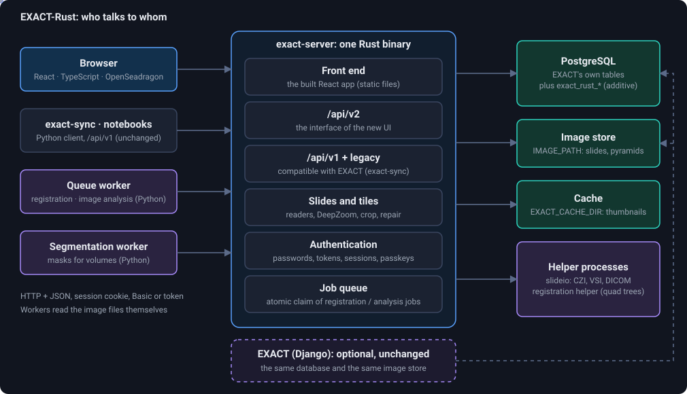
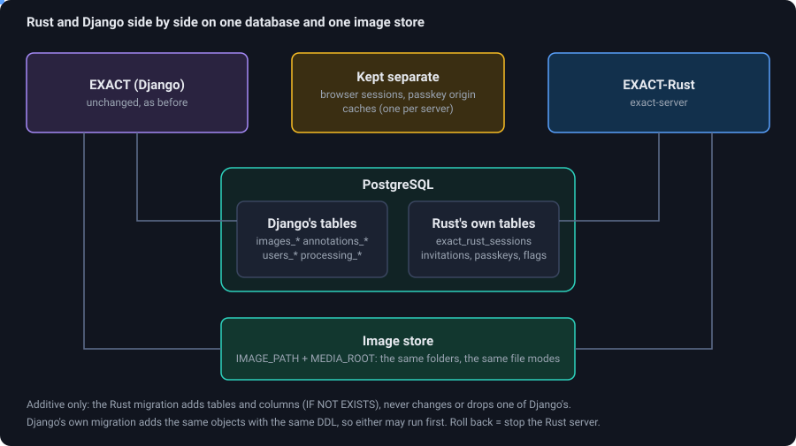

# Architecture

This page explains how EXACT-Rust is built, why, and how the parts talk to each other. Every picture on it is animated: the dots are requests and data moving
through the system.

## The big picture

<figure class="diagram"><figcaption>Everything a user, a script or a worker does goes through one HTTP server. Dashed: the optional, unchanged Django EXACT that shares the data.</figcaption></figure>

EXACT-Rust is **one binary plus PostgreSQL**. The binary (`exact-server`, Axum on tokio) serves

* the **web interface**: the built React application, as static files (`EXACT_STATIC_DIR`),
* the **API**: `/api/v1` (and the legacy paths) exactly as the Django EXACT answered them, and `/api/v2`, the interface of the new web interface and of the workers,
* the **slides**: DeepZoom tiles, thumbnails, crops, downloads, segmentation tiles,
* the **job queue** for workers that register images, analyse them or segment volumes.

What it deliberately does *not* need: Redis (sessions live in PostgreSQL, caches in memory and on disk), a message broker (the job queue is a table with an atomic claim),
gunicorn and nginx for the application itself (put any reverse proxy in front for TLS).

### Design decisions that shape everything else

| Decision | Consequence |
|---|---|
| **The database is EXACT's database.** | Rust and Django can run on the same data at the same time; users move over one by one and back. The Rust migration only *adds* (`CREATE ... IF NOT EXISTS`). See [Running next to Django](coexistence). |
| **`/api/v1` is byte-compatible, `/api/v2` is free.** | exact-sync, QueueRunner and existing notebooks keep working. The new UI only uses v2, which can be clean (snake_case, cursor paging, typed errors). |
| **Heavy work happens outside the server process.** | Machine-learning and registration run in workers (Python, GPU) that poll for jobs. Formats only slideio reads (CZI, VSI, DICOM) go through a helper process. The server stays small and fast. |
| **The viewer's logic is pure functions.** | `frontend/src/viewer-core/` has no framework in it and is unit-tested (annotation geometry, polygon operations, undo history, gestures, shortcuts). Mouse, pen and touch all arrive as pointer events. |
| **Permissions follow teams.** | Every list is scoped to the teams of the caller in the query itself; there is no "list everything, then filter". |

## Crates

<figure class="diagram"><figcaption>The Rust workspace in layers. Each layer lights up in turn from the bottom.</figcaption></figure>

| Crate | What lives there |
|---|---|
| `exact-core` | Configuration (with EXACT's environment variable names: `SQL_*`, `IMAGE_PATH`, `FIDO_SERVER_ID`, ...), error types. |
| `exact-db` | The additive migrations (SQL files), sessions, invitations, passkeys, challenge storage, user lookups. |
| `exact-auth` | Verification of *all* Django password hash formats (so existing accounts log in unchanged), personal access tokens with scopes, WebAuthn (passkeys), the password policy. |
| `exact-wsi` | Slide readers behind one `Slide` trait, the DeepZoom generator (a port of OpenSlide's, including `limit_bounds`), a TIFF reader and writer, pyramid repair, crops, registration of pyramid levels. See [file formats](file-formats). |
| `exact-api` | The HTTP layer: `compat/` (v1 and the legacy paths used by exact-sync), `v2/`, slide and tile routes, uploads, repair, the job queue. |
| `exact-server` | The binary: reads the configuration, runs the migrations when asked, builds the router, serves the static files. |
| `exact-cli` | Operations: `migrate`, `schema-check`, `check-images`, `repair-image`, `precompute-offsets`, `audit-passkeys`, `convert-nrrd-images`. |

Outside the workspace: `frontend/` (React, TypeScript, Vite, OpenSeadragon), `helpers/` (the Python processes: `queue_worker.py` with its plugins,
`segment_worker.py`, `slideio_helper.py`, `registration_helper.py`), `tests/`, `scripts/`, `deploy/`.

## The data model

<figure class="diagram"><figcaption>The entities you meet in the API. The highlight walks the chain Team → Image set → Image → Annotation, which is also the path of permissions.</figcaption></figure>

* A **team** owns **image sets** and **products**. A user sees the image sets of the teams they are a member of; team admins may manage members and invitations.
* A **product** groups **annotation types** (name, colour, vector type: box, fixed-size box, point, line, polygon, global, mask ...). An image set uses the types of the products attached to it.
* An **image** belongs to an image set. It has a file in the image store, pixel size and resolution, and optionally **frames** (z-stack planes, movie frames).
* An **annotation** belongs to an image and has a type, a vector (coordinates in level-0 pixels), flags (concealed, blurred), a verification state and a history (versions).
* An **image registration** relates two images by a 3×3 matrix, optionally with the points it was made from or a pickled quad tree / deformation.
* A **plugin** is announced by a worker; a **plugin job** asks it to process one image (analysis) or two (registration); its **result** holds entries with annotations or bitmaps.

The Rust server adds a few tables of its own (`exact_rust_*`): browser sessions, invitations, passkey challenges, per-user flags and preferences, repair records,
segmentation jobs, linked segmentation volumes, and the measured shifts of pyramid levels (`images_pyramidregistration`). Their foreign keys point *at* Django's tables with `ON DELETE CASCADE`, and no Django table
gets a new constraint, so Django's `delete()` is never blocked by them.

## Where the files are

| Setting | What is in it |
|---|---|
| `IMAGE_PATH` | One folder per image set (`<database>_<team>_<set>` for sets made by the Rust server, the name Django chose otherwise), inside it the image files. Slides that consist of several files (MRXS, VSI) live in sub-folders. |
| `MEDIA_ROOT` | Auxiliary files, plugin icons, registration files, exports. |
| `EXACT_CACHE_DIR` | Thumbnails. Safe to delete at any time. |
| `EXACT_NIFTI_CACHE` | Inflated `.nii.gz` volumes (grows; safe to delete). |

A worker on the same machine reads the same paths: the server puts the absolute path of the image into the job it hands out.

## A request, in detail: one tile

<figure class="diagram"><figcaption>A tile on its way from OpenSeadragon to the pixels and back. The dashed route is the case where the browser already holds the tile.</figcaption></figure>

1. OpenSeadragon asks for `.../tile_files/{level}/{col}_{row}.jpeg` of a DeepZoom pyramid that the server described in a small XML or JSON document before.
2. The request is **authenticated** (session cookie, HTTP Basic or a token) and the image must belong to a team of the caller.
3. The **slide handle** comes from a bounded cache (moka). When it is not there, the file is opened and the reader is chosen by **magic number and extension** (details on the [formats page](file-formats)). OpenSlide handles are never shared between threads: there are two to four per open slide.
4. The region is read from the **best pyramid level** on tokio's blocking pool, so decoding never stalls the event loop.
5. The **DeepZoom generator** scales and crops, and pads at the edge of the image.
6. The tile is encoded (JPEG or PNG) and sent with `Cache-Control: max-age=86400, private`: the browser asks only once per day and tile.

Thumbnails are rendered at most `EXACT_THUMBNAIL_JOBS` at a time and cached on disk. A file that cannot be read is not tried again for five minutes, and the reason
(with image number, file and message) is shown in *Administration → Log*.

## Authentication and sessions

| Way in | Used by | Notes |
|---|---|---|
| Session cookie + `X-CSRF-Token` header | the web interface (`POST /api/v2/auth/login`) | The session is a row in `exact_rust_session`; the CSRF token is returned by the login and by `GET /api/v2/auth/me`. |
| HTTP Basic | exact-sync, notebooks, workers | Verified against Django's password hashes. |
| Personal access token (`Authorization: Bearer ...`) | scripts | Created in Django's UI today; scopes and read-only tokens are honoured. |
| Passkeys (WebAuthn) | the login page, *Preferences → Passkeys* | Bound to `FIDO_SERVER_ID`, so every host name has its own set of usable passkeys. |
| Invitation link | new users | `/invite/{token}`: choose a user name and password. |

A **read-only** flag on an account makes the server refuse every change, whichever way the account signed in. Administrators can **impersonate** a user (API).

## The job queue

<figure class="diagram"><figcaption>The life of a job. Messages appear one after the other and the dot shows the direction of each.</figcaption></figure>

Jobs are rows of Django's `processing_pluginjob` table (so they are shared with EXACT and QueueRunner). Registration jobs additionally link their two images in
`processing_pluginjobimage`. A job's **status is derived from its rows**, not stored: *queued* (no worker, not complete, no error), *running* (a worker is attached),
*done* (100 %, or a result exists), *failed* (an error message).

The **claim** is a single `UPDATE ... WHERE id = (SELECT ... FOR UPDATE SKIP LOCKED LIMIT 1)`: with many workers every job goes to exactly one of them and nobody waits for a lock.
(QueueRunner's old flow, list all jobs, then PATCH, then read again, can hand one job to two workers; the server still answers it unchanged.)
A job whose worker stays silent for 30 minutes is offered again.

## Coexistence with Django

<figure class="diagram"><figcaption>Both servers read and write the same rows and files. Browser sessions, passkey origins and caches stay separate.</figcaption></figure>

This is what makes a gradual move possible: start the Rust server on the production database, let a few users work there, stop it again whenever you like. What the test suite
(`scripts/coexistence.sh`) proves is listed on [Running next to Django](coexistence). The short version: the migration is additive, accounts and tokens work on both, files made by
one server are served by the other, concurrent writes from both leave no orphans, and Django's own `migrate` runs on top of the Rust migration and back.

## Threads and limits

* tokio's multi-threaded runtime, one worker thread per core; slide decoding on the blocking pool. No other thread pools.
* Database connections: a pool of ten per server.
* Uploads are streamed to disk (hashing on the way); no format conversion is needed.
* Slides that only slideio reads go through at most `SLIDEIO_WORKERS` helper processes (about 0.5 GB each).

## How compatibility is tested

`tests/conformance` replays recorded responses of the reference EXACT against this server (about 1700 checks), runs the exact-sync acceptance tests and the mutating v2 suites, and compares the
table structure with what Django creates. `tests/coexistence` runs both servers on one database. `make verify` runs everything; `make e2e` drives the browser.

## Known limits

No window/level in the three-plane view, DICOM images that are not volumes (CT, MR, PET, NM) have no planes, global annotations have no frame, no login rate limiting (restrict access in a beta), no e-mail
(invitations are links; password reset by mail is not ported). More in [Changes from the Django version](django-differences).

The full plan and the log of decisions is [PLAN.md](https://github.com/DeepMicroscopy/Exact-Rust/blob/main/PLAN.md).
