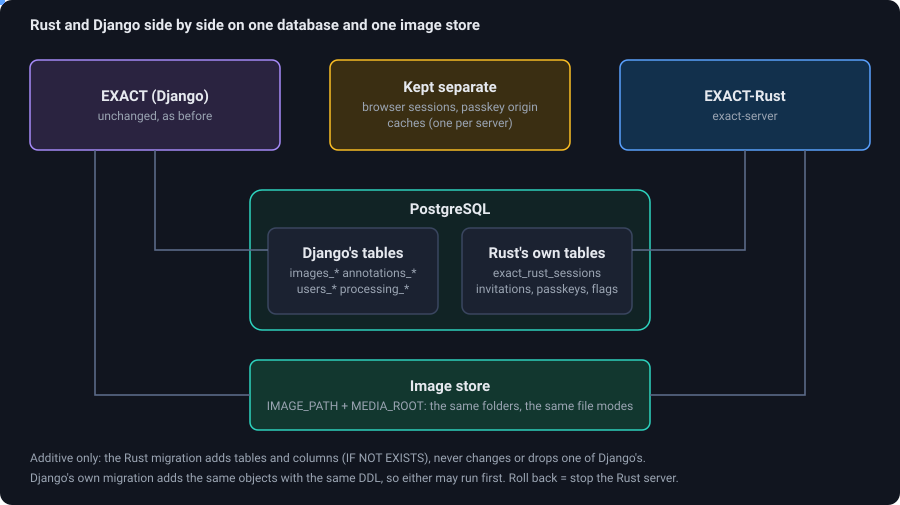

# What is different from the Django EXACT

EXACT-Rust is a port, not a fork: the data, the stored files and the `/api/v1` interface are the same, so existing scripts and the data of existing users carry over. Almost everything else was rebuilt.
This page lists what changed, what is new, what was dropped and what behaves differently, so that you can decide where to move first and what to tell your users.

## At a glance

| | Django EXACT | EXACT-Rust |
|---|---|---|
| **Server** | Django 4.2 + DRF, gunicorn, nginx, Redis | **one Rust binary** (Axum) + PostgreSQL; any reverse proxy for TLS |
| **Database** | PostgreSQL | **the same database**: only additive tables and columns; both can run at once |
| **Files** | image store, media folder | **the same folders**, same names and modes |
| **API** | `/api/v1` (DRF) + legacy `/annotations/api`, `/images/api` | `/api/v1` and legacy **byte-compatible**, plus a new `/api/v2` |
| **Web interface** | server-rendered templates, jQuery, jCanvas | **React single-page app**, OpenSeadragon, touch and pen support |
| **Sessions, caches** | Redis | PostgreSQL sessions; in-memory and on-disk caches |
| **Slide reading** | Python: OpenSlide, tifffile, slideio, pydicom, nibabel, OpenCV | Rust readers + OpenSlide; a **helper process** only for CZI, VSI and DICOM |
| **Plugins** | in-process server plugins **and** external workers (QueueRunner) | external workers only, with a new worker program |
| **Speed** | baseline | 1.3 to 16 times faster median response times on production-size data (24,169 images, 1.4 million annotations); most for the lists exact-sync asks for |

<figure class="diagram"><figcaption>The reason a gradual move works: both servers use the same database and files.</figcaption></figure>

## What stays the same

* **Your data**: every table and file. The Rust migration creates its own tables and adds a few columns (nullable or with a default) with `IF NOT EXISTS`; Django's own migration adds the same objects, so either may run first. Stop the Rust server and Django carries on.
* **Accounts**: all of Django's password hash formats verify, so nobody has to reset a password; personal access tokens work; the permissions model (`auth_permission`, groups) is read as it is.
* **`/api/v1`** for exact-sync, QueueRunner and notebooks, including writes and the legacy endpoints (about 45 paths). This is checked by about 1700 recorded comparisons with the reference server.
* **Configuration names**: `SQL_*`, `IMAGE_PATH`, `MEDIA_ROOT`, `FIDO_SERVER_ID`, `TIME_ZONE` and the rest are read under the names Django used.
* **The shortcuts** of the old interface, and its annotation semantics (vector validation, size units, concealed / blurred flags, verification).

## What is new or extended

Where the Django version already had a feature, the new one re-implements it; this list names what the project records as added or substantially extended.

| Area | New or extended |
|---|---|
| **API** | `/api/v2` (JSON, cursor paging, conditional edits with 409, soft delete and undo); an atomic **job claim** and a one-request **result upload**; `GET /jobs` with worker visibility |
| **Interface** | contextual toolbox, one-click mode, polygon brush and knife, pen mode, zoom slider and zoom step, image adjustments, search history, `?` help with a keyboard, mouse and trackpad view, welcome tour; the three-plane viewer with a 3D render and segmentation tools (brush, lasso, wand, interpolation) and segmentation workers |
| **Accounts** | **invitation links** instead of self-registration; **read-only accounts** (enforced on every route, however the account signs in); worker accounts created with the right permissions in one step |
| **Images** | **pyramid repair** in place with a restorable backup; measured pyramid shifts for CZI, VSI, DICOM and TIFF; a crop that carries its region to **registered images** |
| **Registration** | **DeeperHistReg** including deformable registration; registrations as jobs on one queue with a Jobs page that shows whether a worker is there |
| **Workers** | `queue_worker.py` for registration **and image analysis** plugins (with the [MIDOG 2025 detector](plugins#image-analysis-the-midog-2025-baseline-detector) as a ready plugin); a segmentation worker for volumes |
| **Operations** | **system health** (CPU, GPU, storage, temperature, RAID), a server log in the browser, `exact-cli`, a container image and compose files for this server, an update script with automatic rollback, a coexistence test suite |

## What was dropped

| Dropped | Why / what to use |
|---|---|
| **In-process server plugins** (`ExactServerPlugin`, `pluginFinder`, the hooks that used them) | Python inside the web server; a crashing plugin could take it down. Workers do this now. |
| **Philips iSyntax** | needed a separate container with Philips' SDK. |
| **Conversion on upload** (CZI, multi-page TIFF, HDF5 to pyramidal TIFF with pyvips) | the readers read the files as they are. HDF5 is not supported. |
| **The Django admin site** | replaced by the pages under *Administration* (teams, products and annotation types, users and permissions, plugins, log). |
| **Self-registration and password reset by e-mail** | invitation links and reset links from administrators (the server sends no mail). |
| **The old viewer's heat map**, and scissors and glue for polygons | brush and knife replace the scissors and glue; the heat map had a flawed implementation. `Ctrl+Z` is undo only. |
| **Datasets, tables, tools and messages screens** | not part of the new interface (their data stays in the database). |
| **Per-image statistics** | team statistics are there; the per-image page is not. |
| **Navigator overlay from plugin bitmaps** | results with bitmaps are stored but not drawn; detections (boxes, polygons) of results are shown by the *Analysis* panel |

## Where behaviour differs

These are deliberate or known, and none breaks exact-sync:

* **Personal access tokens cannot be created or revoked** on the Rust server (it validates them): make them in Django's UI.
* **Deactivated users:** Django still accepts the token of a deactivated user; Rust refuses it, on purpose.
* **`PUT` on the REST annotation endpoint:** Django insists on `annotationversion_set` and `uploaded_media_files` in the body; Rust does not (a client that works on Django works on Rust).
* **v1 creation of image sets** (`POST /api/v1/images/image_sets/`) and **deletion of teams** answer 501; use `POST /api/v2/image-sets`, `DELETE /api/v2/teams/{id}`. The old URL `GET /images/api/image/delete/<id>/` does not exist (`DELETE /api/v2/images/<id>`). exact-sync uses none of them.
* **`register_images`** (exact-sync) queues a job and waits for the worker (`REGISTRATION_WAIT_SECONDS`, default 900) instead of computing inside the request; it answers 201 / 202 like Django, and 202 with the job when the wait ran out.
* **Unknown URLs** answer with the web app's start page (status 200) when the web app is served, not a 404.
* **Six simultaneous uploads of one file:** Django creates six images (it checks, then inserts, with no unique constraint); with both servers fewer. Not a coexistence problem.
* **Requests Django answers with HTTP 500** (an empty Basic password, `annotations?deleted=<bool>`, `images?expand=annotations`) are not reproduced.
* **Time zone:** both servers must run with the same `TIME_ZONE`, or timestamps they write differ; the coexistence test fails if they do not match.
* **Passkeys** are bound to a host name (`FIDO_SERVER_ID`): a passkey enrolled on the Django host works on the Rust host only if its id is the same or a parent domain.
* **The read-only flag** lives in a table of the Rust server, so Django does not know it: while a database is shared, a read-only account is read-only on Rust only.
* **PostgreSQL 12 works:** annotation UUIDs are generated in the application (`gen_random_uuid()` is built in only from 13).

How all of this is tested: [Running next to Django](coexistence).

## Moving over: a suggestion

1. Read [Running next to Django](coexistence) and run `scripts/coexistence-preflight.sh` (read-only).
2. Take a `pg_dump`. Run `exact-cli migrate --confirm-db <name>` once. Give the Rust server its own host name and `FIDO_SERVER_ID`.
3. Let a few users work on Rust for a week; they keep their accounts, teams and passwords. Everything they do is visible in Django at once.
4. Move registration, analysis and segmentation workers over (they use `/api/v2`, or keep QueueRunner on `/api/v1`).
5. When the last user has moved, stop Django. To go back at any time, stop the Rust server.

A worked example of the production setup, including the container networks, PostgreSQL 12 and the update script, is in [Installation §10](DEPLOY#10-production-next-to-the-running-django-the-same-database-and-image-store).
