# Supported file formats

EXACT-Rust reads the formats the Django EXACT read, with native readers wherever it could (no conversion on upload), a Python helper for the three formats only slideio understands, and one format dropped.
The server decides by **content** (magic numbers) and extension, never by extension alone.

## Overview

| Kind | Formats | Reader | In the viewer |
|---|---|---|---|
| **Whole-slide scanners** | Aperio SVS, Hamamatsu NDPI / VMS / VMU, Leica SCN, 3DHISTECH MIRAX (MRXS), Philips TIFF, Sakura SVSLIDE, Trestle, Ventana BIF / TIFF, tiled TIFF, DICOM whole-slide (with OpenSlide 4) | **OpenSlide** (the library is loaded at run time; without it the server still starts, with these formats off) | pyramid, DeepZoom tiles |
| **Pyramidal TIFF / BigTIFF** | files from libvips, ImageMagick, converters; classic TIFF and BigTIFF, little and big endian | own reader (`generic_tiff.rs`) | pyramid |
| **OME-TIFF** | single series and multi-series **z-stacks** (one series per plane, SubIFD levels); label and thumbnail series are ignored | own reader (`ome.rs`) | pyramid + **frame slider** |
| **Plain images** | JPEG, PNG, TIFF without scanner metadata | decoded once, one level | single level |
| **Zeiss CZI**, **Olympus VSI** | `.czi`, `.vsi` (with its `_name_` data folder) | **slideio**, in a helper process | pyramid |
| **DICOM** | whole-slide and compressed images through slideio; **uncompressed volumes** natively | slideio / own reader | pyramid, or **three-plane view** for CT, MR, PET, NM volumes |
| **NIfTI** | `.nii`, `.nii.gz` | own reader (inflated copies are cached) | **three-plane view**, 3D render |
| **Movies** | MP4, AVI | ffmpeg (libav*) | frame slider, play button |
| **Cellvizio** | MKT | own reader | frames |
| **Segmentations** | NRRD label maps, 3D Slicer `.seg.nrrd` | linked to a NIfTI volume, not an image | drawn over the volume's planes |
| **Documents** | PDF, DOCX, XLSX, DOC, XLS, PPTX, PPT, CSV, TXT, JSON, SQLite | stored as **auxiliary files** of the image set | *Files* dialog, download |
| **Archives** | ZIP | unpacked into the image set; a `.mrxs`, `.vms` or `.vsi` inside selects the files that are images | |
| ✗ | Philips iSyntax | dropped: the Django version needed a separate container with Philips' SDK | |

What OpenSlide reads depends on the library version installed on the server (OpenSlide 3.4 and 4.x differ, for example for DICOM). <code>openslide.detect_vendor</code> decides; the format is supported when OpenSlide recognises the file. A file that nobody can read is reported in <em>Administration → Log</em> with the reason.

## How a reader is chosen

<figure class="diagram"><figcaption>The rules in the order the server tries them; the first that matches reads the file.</figcaption></figure>

This is a port of EXACT's `getSlideHandler`. Two details matter in practice:

* **TIFF is checked by magic number in both byte orders** (and BigTIFF). Big-endian files exist in the wild (a Bio-Formats OME-TIFF in the test data) and were once served from a single level, decoding the whole image for every thumbnail.
* **NDPI is never treated as a plain TIFF**, even though it is one: it goes to OpenSlide.

All readers implement the same small interface (`Slide`): levels and their downsamples, `read_region(x, y, level, w, h, frame)`, the number of frames, labels for the frames, pixel size and objective power. Everything above it (tiles, thumbnails, crops, screenshots, workers' patches) is written once.

## What happens on upload

Each file goes through the same steps (`POST /api/v2/image-sets/{id}/images`, or the drop area of an image set):

1. The file is **streamed to disk** into the image set's folder, hashed on the way. A name that exists already asks you whether to keep both, replace, or skip.
2. A **ZIP** is unpacked. An archive that holds a `.mrxs`, `.vms` or `.vsi` makes only those files images; the other files are the slide's data.
3. **Documents** become auxiliary files, **`.nrrd`** becomes a segmentation file that waits to be linked to a volume.
4. Anything else is **opened by the readers**. The row gets width, height, pixel size (µm per pixel), objective power, the frame descriptions (and a default frame in the middle for z-stacks and volumes). A file that cannot be read is removed again and reported as *unsupported*.

No conversion happens. (Django converted CZI, multi-page TIFF and HDF5 to pyramidal TIFF with pyvips; here CZI is read as it is, through slideio, and TIFFs by the TIFF readers. HDF5 is not supported.)

## When a file cannot be read

The viewer only says *The slide cannot be read*. The cause is in *Administration → Log* (and in the server's log), and `exact-cli inspect <file>` opens one file the way the server does and prints the reader, the size, the levels and frames, or the reason it fails (in the container: `docker exec <container> exact-cli inspect /data/images/<set folder>/<file>`).
A `.nii.gz` volume is inflated once into the folder `EXACT_NIFTI_CACHE` (it can be deleted at any time). If that folder is full the oldest copies are removed until the new one fits, and if it cannot be written to at all the system temp directory is used instead; if that fails too, the log says so.

## Damaged pyramids

TIFFs whose zoom pyramid is not a copy of level 0 show up as tiles that "wobble" when you zoom. The viewer then offers a **one-time repair**: the pyramid is rebuilt from level 0 and the original is kept as `<name>.orig.<ext>`, restorable. On the command line: `exact-cli check-images <folder>` finds them, `exact-cli repair-image <file>` repairs one.
Formats whose levels are shifted against each other (CZI, VSI, DICOM, OME and generic TIFF) get their shift measured once and stored (`exact-cli precompute-offsets`), so that the first opening does not wait for the measurement.

## Resolution and units

Annotations are stored in **pixels of level 0**. When the file knows its resolution (µm per pixel) the interface shows areas in µm² or mm², lengths in µm or mm, and annotation types can have a default size in µm or mm that is converted to pixels per image. Volumes are measured in millimetres, so a brush of 8 mm is round in every plane.

## Workers and formats

A worker reads the file itself. By default it uses OpenSlide, which reads the scanner formats and TIFF. With `--exact-dir <EXACT checkout>/exact` (the container image has it) a worker uses **EXACT's own slide readers**, which read every format EXACT reads: so registration and analysis plugins work on CZI, VSI and the rest, too. A plugin that needs a special reader can say so in its `unavailable()` check.

| Where | Formats it can open |
|---|---|
| server (viewer, tiles, thumbnails) | everything in the table above |
| worker without `--exact-dir` | OpenSlide formats, TIFF |
| worker with `--exact-dir` (container default) | as EXACT: everything slideio, OpenSlide and EXACT's own readers open |
| segmentation worker | none: it receives the voxels over HTTP |

## Adding a format

Implement the `Slide` trait in `crates/exact-wsi/src/` (look at `generic_tiff.rs` for a small reader and `nifti.rs` for a volume), add the detection rule to `formats.rs` before the rule it must win against, and add a test file. Formats that need a heavy foreign library are better behind a helper process like slideio's: the server stays small and a crash in the library cannot take it down.
