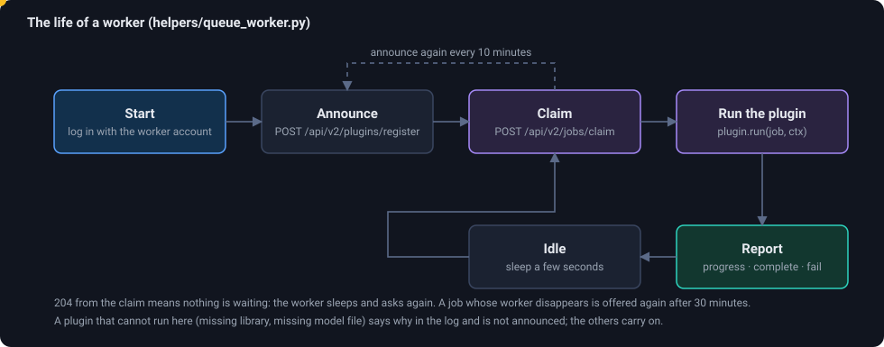

# How to create your own plugin for EXACT

A plugin teaches EXACT to do something with images that it cannot do itself: find cells, align two slides, segment a volume. You write a small Python class; a **worker** program runs it whenever a user (or a script) asks for it.
This page builds two complete plugins and runs them. Background and the full protocol: [Plugins and workers](plugins) and the [API](api#examples-jobs-and-workers).

<figure class="diagram"><figcaption>What happens around your code: the worker announces your plugin, claims a job, calls your method, and reports.</figcaption></figure>

## Which kind do you need?

| You want to... | Write a... | You implement | Your code returns |
|---|---|---|---|
| mark things in one image (cells, regions, artefacts) | **image analysis plugin** | `analyze(image_path, params, ctx)` | `AnalysisResult`: boxes with scores |
| align two images | **registration plugin** | `register(source_path, target_path, params, ctx)` | `RegistrationResult`: a 3×3 matrix |
| segment a 3D volume | **segmenter** (other worker, see [Plugins](plugins#segmenters)) | `segment(volume, spacing_mm, params, progress)` | a mask array |
| do something else with the API | **a worker of your own** (see the end of this page) | the protocol | whatever you store |

## 1. Set up a place to try it

You need a running server, an account for the worker, and the repository's `helpers/` folder.

```bash
# the server on your own machine (see the README: make ui, cargo build -p exact-server, SQL_* variables)
EXACT_LISTEN=127.0.0.1:8002 target/debug/exact-server

# a worker account: in the web interface, Administration → Users → New worker account…
#   (it needs processing.add_plugin and processing.change_pluginjob, and must be a member of the teams whose images it serves)
export EXACT_URL=http://127.0.0.1:8002 EXACT_USER=my-worker EXACT_PASSWORD=...

python -m pip install numpy opencv-python-headless openslide-python   # what the example below uses
```

The worker needs to read the image files at the **same paths as the server** (the job carries absolute paths). On one machine that is automatic.

## 2. An image analysis plugin, step by step

The complete file is `helpers/plugin_examples/dark_regions.py` (it is tested together with the server). It finds dark regions and stores them as boxes.

### The shell

```python
from plugins_common import open_slide
from queue_plugin import AnalysisResult, ImageAnalysisPlugin, param

class DarkRegions(ImageAnalysisPlugin):
    name = "Example: dark regions"            # what users see
    package = "org.example.dark-regions"      # unique id (also tells apart two plugins with one name)
    parameters = [
        param("darkness", "int", 90, "Darkness", "Grey values below this count as dark.", min=1, max=254),
        param("min_area", "int", 50, "Smallest region", "Smaller regions (on the overview) are ignored.", min=1, max=100000),
        param("annotation_type", "text", "annotation", "Annotation type", "Stored as the type of the image set whose name contains this."),
    ]
    ...
PLUGINS = [DarkRegions()]                      # the worker looks for this list in every .py file of the plugin folder
```
`parameters` is the **schema**: the worker sends it to the server, and the web interface builds a form from it. A parameter is `param(name, type, default, label, help, **limits)`; types are `int`, `float`, `bool`, `text` and `choice` (`choices=[...]`); `min`, `max` and `step` bound numbers.

### Say when you cannot run

```python
    def unavailable(self):
        try:
            import cv2, numpy
        except ImportError as e:
            return f"OpenCV and numpy are required ({e})"
        return None
```
A plugin that returns text here is **not announced**; the worker prints the reason and serves the others. Use it for missing libraries and missing model files, so that a worker is never advertised for jobs it would fail.

### The work

```python
    def analyze(self, image_path, params, ctx):
        slide = open_slide(image_path, ctx.exact_dir)         # any format the worker can read
        width, height = slide.dimensions
        level = max((i for i, d in enumerate(slide.level_downsamples) if d <= 16.5), key=lambda i: slide.level_downsamples[i])
        w, h = slide.level_dimensions[level]; ds = slide.level_downsamples[level]
        overview = np.array(slide.read_region((0, 0), level, (w, h)).convert("RGB"))
        ctx.progress(30)                                      # the Jobs page shows it

        grey = cv2.cvtColor(overview, cv2.COLOR_RGB2GRAY)
        mask = (grey < params["darkness"]).astype(np.uint8)
        _, _, stats, _ = cv2.connectedComponentsWithStats(mask)
        found = []
        for x, y, bw, bh, area in stats[1:]:                  # row 0 is the background
            if area >= params["min_area"]:
                found.append({"vector": {"x1": round(x * ds), "y1": round(y * ds),
                                         "x2": min(width, round((x + bw) * ds)), "y2": min(height, round((y + bh) * ds))},
                              "score": min(1.0, float(area) / (w * h) * 20)})
        return AnalysisResult(found, params["annotation_type"], "Dark regions", default_threshold=0.0)
```

What to know:

* **`image_path`** is a file on the server. **`open_slide(path, ctx.exact_dir)`** returns an object with `dimensions`, `level_dimensions`, `level_downsamples` and `read_region((x, y), level, (w, h))` (x and y in *level-0* pixels, like OpenSlide), for every format the worker can open.
* **Coordinates in the result are level-0 pixels** of the image. A box is `{"x1", "y1", "x2", "y2"}` with `x2 > x1` and `y2 > y1`; a polygon is `x1, y1, x2, y2, x3, y3, ...` (at least three points); a type of another shape needs the vector of that shape. **The server checks every detection against the annotation type** when you store the result, with the rule that applies to annotations made by hand: a result with an invalid vector is refused whole, with a `400` that names the detection (`detections[17]: the vector is not valid for the annotation type "Mitotic figure" (a box needs ...)`). Round and clip your coordinates, and drop boxes that end up empty.
* **`score`** is any number; users can threshold on it. `default_threshold` is the score from which the result is shown at first.
* The second argument of `AnalysisResult` names the annotation type: the **first type of the image set whose name contains it** (case-insensitive) is used. If the set has none, the job fails with "Missing annotation type", which tells the user what to add.
* **`params`** are your defaults merged with the job's values. (Analysis jobs created today carry no parameters, so the defaults decide; give them sensible values.)
* **Long runs:** call `ctx.progress(percent)` now and then (0 to 99; the server records it, and a job that stays silent for 30 minutes is offered to another worker). Use `ctx.log(text)` for the worker's console.
* **Errors:** raise. The worker reports the traceback as the job's error; the job shows as *failed* with the text and can be restarted.
* A heavy model should be loaded **once** and kept (an attribute of the plugin object, created on the first job): see `helpers/plugins/midog2025_fcos.py` for the full pattern, with batching and reading patches ahead of the GPU.

### Run it

```bash
python helpers/queue_worker.py --plugins helpers/plugin_examples --only dark --once
#   announces "Example: dark regions" and exits (nothing to do yet)
```
Now ask for a job, as a user or script would, and run the worker again:

```bash
curl -u my-worker:... -X POST $EXACT_URL/api/v2/plugin-jobs -H 'content-type: application/json' \
     -d '{"plugin": <the plugin id from Administration → Plugins>, "image": 2}'
python helpers/queue_worker.py --plugins helpers/plugin_examples --only dark --once
#   job 223: Example: dark regions: image 2
#   job 223: done, 1 detections in 0 s
```
The job shows as **done** on the Jobs page. Without `--once` the worker keeps polling every five seconds (`--interval`). Open the image in the viewer and click the **robot button**: the *Analysis* panel lists the result (tick it to draw the boxes over the image, with a threshold slider on `score`) and every plugin available for the image set with a **Run** button and its parameters. The same data is at `GET /api/v2/plugin-results`.

## 3. A registration plugin, step by step

`helpers/plugin_examples/shift_registration.py` is the whole interface in a few lines:

```python
from queue_plugin import RegistrationPlugin, RegistrationResult, param

class ShiftRegistration(RegistrationPlugin):
    name = "Example: fixed shift"
    package = "org.example.fixed-shift"
    parameters = [param("shift_x", "float", 100.0, "Shift x", "pixels to the right", min=-100000, max=100000),
                  param("shift_y", "float", 0.0, "Shift y", "pixels down", min=-100000, max=100000)]

    def register(self, source_path, target_path, params, ctx):
        matrix = {"t_00": 1.0, "t_01": 0.0, "t_02": params["shift_x"],
                  "t_10": 0.0, "t_11": 1.0, "t_12": params["shift_y"],
                  "t_20": 0.0, "t_21": 0.0, "t_22": 1.0}
        return RegistrationResult(matrix=matrix, error=0.0, runtime=0)

PLUGINS = [ShiftRegistration()]
```

* The matrix maps **source pixels onto target pixels**, level 0, row by row: `x' = t_00·x + t_01·y + t_02` and so on. The bottom row is `0 0 1` for an affine transformation.
* `error` is the mean distance in *target pixels* (the number users read in the list); `runtime` is seconds.
* A real plugin opens both images with `open_slide`, computes features, and fits a matrix. If it keeps richer data (a quad tree, a deformation), pass `file=pickle.dumps(...)`: the server stores it and converts points through your model; see `helpers/plugins/qt_wsi_registration.py`.
* **The parameters appear in the Register dialog** under *Parameters*, and users can set them per job; `params` arrives with their values merged over your defaults.

Try it: run the worker with `--only shift --once` (announce), register two images in the web interface choosing *Example: fixed shift* as the method, then run the worker again. The registration appears with your matrix, and the overlay moves accordingly.

## 4. Test it without a server

`analyze` and `register` are ordinary methods. Call them directly:

```python
import queue_plugin
from plugins.midog2025_fcos import PLUGINS          # or your module

plugin = PLUGINS[0]
assert plugin.unavailable() is None
ctx = queue_plugin.Context(log=print, progress=lambda p: print("progress", p))
result = plugin.analyze("/path/to/slide.svs", plugin.defaults(), ctx)
print(len(result.detections), result.detections[:2])
```
For the whole path through a real server, copy `tests/conformance/test_example_plugins.py`: it announces the example plugins, creates a job, runs the worker with `--once` and checks the job and the stored result.

## 5. Deploy it

1. Put the file into `helpers/plugins/` (the worker loads every `*.py` there) or into a folder of your own and start the worker with `--plugins <folder>`. `--only <text>` serves only plugins whose name or file contains the text, handy for a dedicated GPU worker.
2. **In the container image** the worker is `python /app/helpers/queue_worker.py ...` with the account in `WORKER_USER` and `WORKER_PASSWORD`; the image has numpy, OpenCV and CUDA PyTorch. Extra Python packages go into your own `Dockerfile` layer; model files go into a folder mounted read-only at `/models` (`MODELS_PATH` in `exact.env`). See [Installation](DEPLOY#4e-mitotic-figure-detection-midog-2025-baseline).
3. **The account** needs `processing.change_pluginjob` and `processing.add_plugin`, and (for registration plugins) `images.change_imageregistration`, and must be a **member of the teams** whose images it should work on.
4. **Check**: *Administration → Plugins* lists your plugin with the worker that serves it and when it was last seen. A job that nobody serves stays *queued*, and the Jobs page says that no worker has asked for work lately.
5. Several workers can serve the same plugin; every job goes to exactly one.

## 6. Checklist for a good plugin

- [ ] a **unique `package`** and a clear `name`
- [ ] `unavailable()` says what is missing instead of failing later
- [ ] sensible **defaults** (jobs created from scripts use only those); limits (`min`, `max`) on numbers
- [ ] **coordinates in level-0 pixels**, validated for the annotation type's shape
- [ ] `ctx.progress` for anything longer than a few seconds
- [ ] the **model loaded once**, not per job
- [ ] works on **images smaller than your patch size** and without a pyramid (the MIDOG plugin was fixed for exactly this)
- [ ] raises with a message a user can act on ("The image set needs an annotation type called ...")

## A worker without our Python framework

The protocol is plain HTTP; any language works. This is a complete worker in Python with only `httpx`:

```python
import httpx, time

c = httpx.Client(base_url="http://127.0.0.1:8002", timeout=60)
c.headers["x-csrf-token"] = c.post("/api/v2/auth/login", json={"username": "my-worker", "password": "..."}).json()["csrf_token"]

plugin = c.post("/api/v2/plugins/register", json={"name": "Bare detector", "package": "org.example.bare",
                                                  "plugin_type": 1, "parameters_schema": []}).json()
while True:
    r = c.post("/api/v2/jobs/claim", json={"worker": "bare-1", "kinds": ["plugin"], "plugin": plugin["id"]})
    if r.status_code == 204:                      # nothing waiting
        time.sleep(5)
        continue
    job = r.json()["job"]                          # job["image_path"], job["annotation_types"], ...
    atype = next(t for t in job["annotation_types"] if "annotation" in t["name"].lower())
    detections = [{"vector": {"x1": 100, "y1": 100, "x2": 150, "y2": 150}, "score": 0.9}]   # your analysis here
    c.post(f"/api/v2/plugin-jobs/{job['id']}/complete",
           json={"worker": "bare-1", "annotation_type": atype["id"], "name": "Bare", "detections": detections}).raise_for_status()
```
Add `POST /api/v2/plugin-jobs/{id}/progress` while you work and `POST .../fail` with `{"worker", "error", "detail"}` when you cannot finish. A registration worker uses `kinds: ["registration"]` and `/api/v2/registration-jobs/{id}/complete`. All of it is shown with real requests in the [API examples](api#examples-jobs-and-workers).

If you already have a worker built on **exact-sync** and QueueRunner (a handler with an `inference_func`), it keeps working unchanged against `/api/v1`; see [QueueRunner and the v2 claim](queuerunner-v2).
