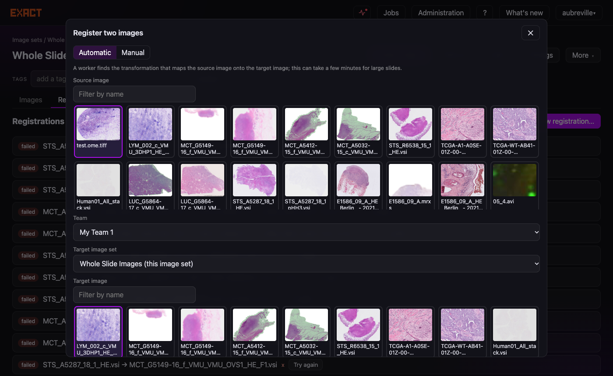

# How to use image registration

## What is image registration?

Two scans of the same tissue never line up by themselves. A second section cut from the block lies a little rotated on the glass, is shifted, stretched or torn; a scan on another scanner has a different origin and resolution.
**Registration** finds the *transformation* that tells you, for any point in one image, where the same tissue point is in the other. Once you have it, you can lay one image over the other, jump to the same spot, cut matching crops, and carry annotations from one image to the other.

<figure class="diagram"><figcaption>The idea in three steps: matching points, a fitted transformation, and the images agree. The bar on the right is the distance of the point pairs.</figcaption></figure>

In EXACT a registration always has a direction and a **matrix**:

* **Source** is the image you register, **target** the one it is registered *onto*. A point `x` of the source lies at `x' = M · x` in the target, in the pixels of the full-resolution images.
* `M` is a 3×3 matrix (the *homogeneous* form of "rotate, scale, shear and shift"). Its entries are called `t_00` ... `t_22` in the API.
* The **error** is how far, on average, the mapped source points land from where they should: **in target pixels**. A mean error of 2 px on a 100,000 px wide slide is excellent; 200 px is not.
* Some methods store more than the matrix (a *quad tree* of local transformations, or a full *deformation field*), because real tissue does not move as one rigid piece. EXACT then converts points through that richer model, and keeps the matrix as the best overall fit.

| Kind | Allows | Typical use |
|---|---|---|
| **Rigid** | rotation + shift | the same section scanned twice |
| **Similarity** | + uniform scale | scanners with different pixel sizes |
| **Affine** | + shear, different x/y scale | neighbouring sections on a slide |
| **Deformable** | + local stretching and tearing | sections where the tissue moved unevenly |

**Why pathologists use it:** serial sections stained differently (H&E and an immunohistochemistry stain such as PHH3 or Ki67) show the same structures; with a registration you look at the same region in both, you use the IHC stain as a *reference* for what you annotate on the H&E, and you cut the same region from every stain for a study.

## What you need

* **Two images** you can read, the source in an image set you may edit (any member of the team may) and the target anywhere you may read. They may be in different image sets and teams.
* For **automatic** registration, a **registration worker** that serves a plugin (Administration → Plugins shows which and when it last asked for work). Without one the job waits in the queue, and the Jobs page tells you that nobody has asked lately. Manual registration needs no worker.

## Way 1: automatic

1. In the image set, tick the two images and click **Register these two…**, or open the **Registration** tab and click **New registration…**.
2. Choose **Automatic**. Pick the **source image** (the one that moves) and the **target image**; the target may be in another team and image set. The picker has a name filter.
3. Leave **Also create the inverse registration** on if you want to go both ways later (it gives the target-onto-source matrix; it is cheap).
4. If several methods are installed, choose one under *Registration method*; **Parameters** opens the plugin's settings.
5. **Start.** The job appears under *Jobs* (queued, then running, then done) and the pair under *Registrations* with its error in pixels.



<figure class="diagram"><figcaption>The two ways end in the same record.</figcaption></figure>

**Which method?**

| Method | Good at | Settings worth knowing |
|---|---|---|
| **DeeperHistReg** | most tissue; stains that look very different; large slides | *Mode*: `affine` (default) or `deformable` (needs a GPU for large slides); *Initial transform*: `rigid` or `affine`; *Overview size* (4096 px): the tissue is cut out first, so scans that are mostly glass keep their resolution; *Registration size* (2048): lower it if the job fails with "CUDA out of memory"; *SIFT* and *SuperGlue* switches (SuperGlue finds more in faint stains) |
| **Multi-stage (features + refinement)** | when the matrix has to be **exact**, for example to compare cells at high magnification: the feature based result is corrected on the slides themselves, to a few slide pixels; any stain pair | *Rough alignment* (`auto`: DeeperHistReg if the worker has it, else SIFT), *Refine* (off gives the rough alignment alone), *Refinement resolution* (4096 px across the tissue; higher is more exact and slower), *Tile size*, *Recursions*; and the DeeperHistReg settings below it. Plan for a few minutes on a large slide |
| **Quad-tree SIFT** | similar stains; piecewise results | *Features per tile*, *Match ratio* (lower = stricter), *Quad-tree depth* (0 = one transformation for the whole slide; higher refines locally), *Thumbnail size* |

**How the multi-stage method gets its accuracy.** A feature method (DeeperHistReg, SIFT) works on an overview of a few thousand pixels across a slide that is a hundred thousand pixels wide: one overview pixel is many micrometres, so a matrix that is "a pixel off" is hundreds of slide pixels off. The multi-stage plugin keeps the feature method for what it is good at (finding the right alignment of any stain pair, robustly) and then measures the remaining offset on the slides themselves, going down in steps: (1) a pyramid from 512 up to the *Refinement resolution* pixels across the tissue, each step correcting the matrix by the enhanced correlation coefficient of *structure images* (gradient magnitude of the optical density, which looks the same for H&E and an immunostain); (2) tiles over the tissue, their shifts measured by phase correlation and combined by a robust affine fit, repeated for the *Recursions*; (3) about a hundred patches of the richest tissue read at 16, 8 and 4 slide pixels per pixel, again measured and fitted. Parts where the two sections really differ (a fold, a missing piece) are outliers and do not count. Every step is kept only if the two slides agree better afterwards, so the refinement can fail to improve a matrix but not worsen it. The *error* in the list is what the patches still show after the final matrix, in target pixels: it cannot fall below about one pixel of the finest level (4 slide pixels) and is larger where the sections differ from each other.

## Way 2: manual

Use it when the automatic result is wrong, the images are tiny, or you want to be sure.

1. In the same dialog choose **Manual**, the two images, and click **Pick points…**. Two viewers open side by side: the source on the left, the target on the right.
2. **Click a distinctive spot in the left image** (a vessel branch, the corner of a tissue fold, an isolated cell cluster), then **the same spot in the right image**. A numbered marker appears on both, and a crosshair stays on the first until you have set the second.
3. Repeat. **One pair gives a shift, two a shift + rotation + scale, three or more a least-squares affine fit.** Spread the points widely over the tissue, not close together: errors grow away from your points.
4. Remove a wrong point with the **×** on its chip. **Save registration** stores it and shows the mean error in pixels. Leave *Also create the inverse registration* on to get both directions.
5. The check view opens: it lays the source over the target. Move the slider to compare; **Edit the points** goes back to the picking.

## Check the result

* The list under *Registration* shows the **error** and the time it took. Compare it with the size of the structures you care about, not with the image size.
* **Review** lays the source over the target through the stored registration; the slider fades between them. Look at several places, especially the far edges of the tissue.
* A **deformable** result is exact where the matrix alone is not: the overall matrix may look poor while the deformation is right. Judge by the overlay.
* Wrong? **Recompute** (automatic again, perhaps with other settings), **Redo manually**, or **Delete**.

## Use it

**Overlay in the viewer.** Open an image that has registrations: the **Overlay** drop-down in the viewer bar lists the images registered with it (in either direction; the other direction is computed through the inverse). Choose one and use the **opacity slider**; `O` switches the overlay off and on. Under *Preferences → Viewer* you can switch on *Auto-enable first overlay* and set the *default overlay opacity*.

**Crop the same region from every stain.** *Crop to new image* offers to crop the registered images **at the same place** (the region is carried over through the registration), each into an image set you choose. The crops keep a registration between them, so they overlay at once.

**Carry annotations and points across** (API): convert a vector from source to target.

```bash
curl -b jar.txt "$HOST/api/v2/registrations/86/convert?vector=%7B%22x1%22%3A1500%2C%22y1%22%3A1500%7D"
# {"x1": 1600.0, "y1": 1550.0}
```
A box needs two points (`x1,y1,x2,y2`), a polygon as many as it has. With exact-sync the same is `convert_coodinates` (note Django's spelling) on the registration. See the [API examples](api#examples-registration).

**Script it.** `POST /api/v2/images/{id}/register {"target_image": id}` queues an automatic registration; `POST /api/v2/registrations/manual` registers by points. A complete example with DeeperHistReg, its parameters and waiting for the result: [API examples](api#queue-a-registration-with-deeperhistreg-and-wait-for-it). exact-sync's `register_images` works as before (it waits for the worker).

## When something goes wrong

| What you see | Why, and what to do |
|---|---|
| Stays **queued** | no worker is serving a registration plugin. Check Administration → Plugins; start the worker (`helpers/queue_worker.py`, or the compose service). |
| **Failed**, with a text | open the red text on the Jobs page. *Restart* queues it again. For "CUDA out of memory" lower *Registration size*. |
| The overlay is **rotated or flipped** | the stains differ a lot or the section is mirrored. Try *Initial transform: affine*, a larger *Overview size*, or register manually with three points far apart. |
| The overlay is good in the middle and **bad at the edges** | the tissue deformed. Try *deformable*, a deeper quad tree, or add manual points near the edge. |
| The API answers **"Source and target image have to differ"** | source and target are the same image. (The dialog does not let you start with the same image twice.) |
| I registered A onto B but need B onto A | **Add inverse** on the registration. |
| The job **disappeared** | somebody removed it from the Jobs page. A running job whose worker went silent for 30 minutes is queued again by itself. |

## Under the hood

A registration is a row in `images_imageregistration` (source, target, the 3×3 matrix, the error, the run time, optionally a file with the quad tree or deformation, and for manual ones the points). An automatic job is a row in `processing_pluginjob` that links its two images; the worker claims it, runs the plugin and returns the matrix with `POST /api/v2/registration-jobs/{id}/complete`. Details: [plugins and workers](plugins) and the [API](api#examples-registration). To add your own method, see [How to write a plugin](howto-plugin).
