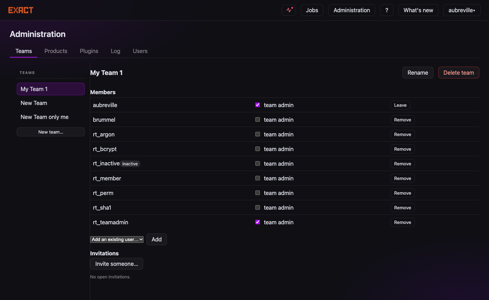
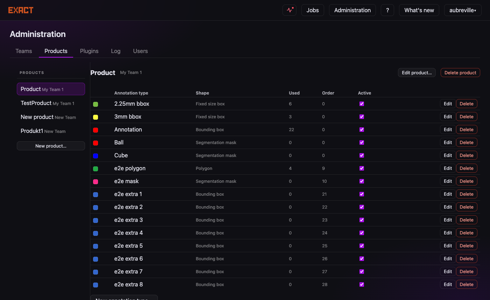
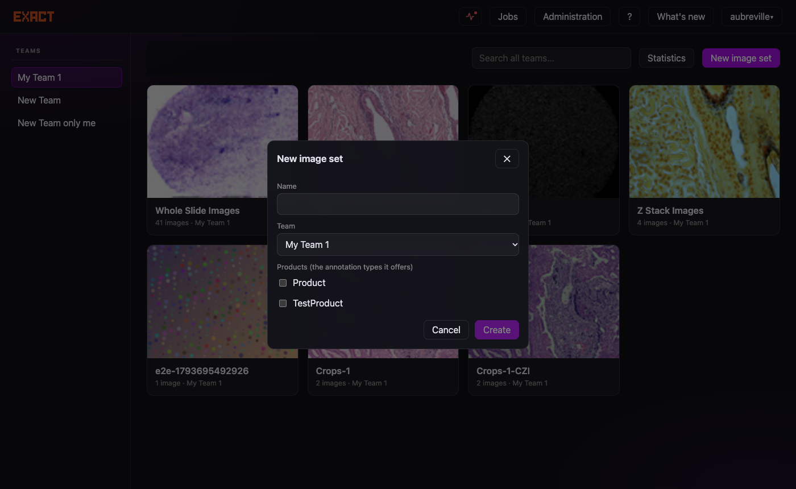
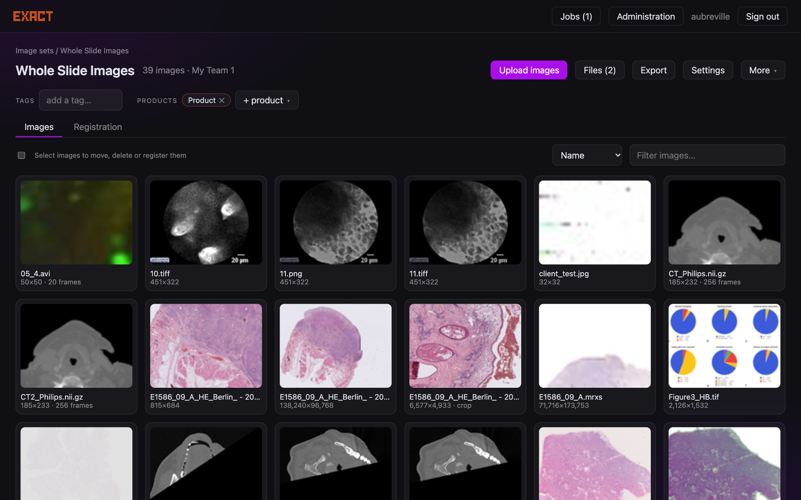
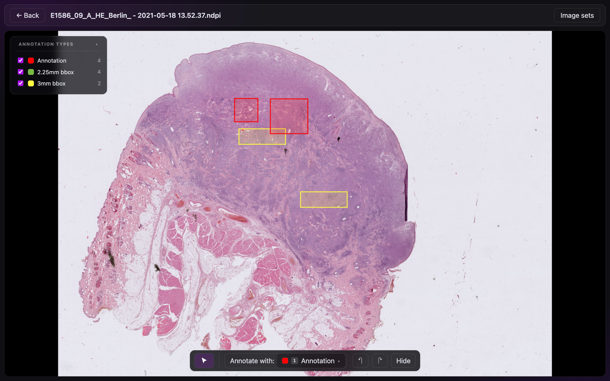

# How to create a team and use EXACT for your image management

You will set up a project from nothing: a **team** for the people, **annotation types** for what you mark, an **image set** for the slides, and then upload, annotate and export.
It takes about ten minutes. Everything can also be done through the [API](api); the equivalent calls are at the end of each step.

<figure class="diagram"><figcaption>The seven steps. Steps 1 to 4 are done once per project; 5 to 7 are daily work.</figcaption></figure>

## The five words you need

| Word | Meaning |
|---|---|
| **Team** | A group of people. Everything is shared *within* a team: you see the image sets of the teams you belong to, and nothing else. |
| **Team admin** | A member who may add and remove members, invite people and rename the team. The person who creates a team is its first admin. |
| **Product** | A named collection of annotation types ("Mitosis study"). It belongs to a team. |
| **Annotation type** | What you can mark: a name, a colour and a shape (box, fixed-size box, point, line, polygon, whole-image label, mask). |
| **Image set** | A folder of images with tags. It belongs to a team and offers the annotation types of the products attached to it. |

Why products? You can attach the same product to many image sets, and one image set may use several products. Changing an annotation type once changes it everywhere it is used.

## Step 1. Create the team

1. Sign in and open **Administration** (top right) → **Teams**.
2. Click **New team…**, enter a name (3 to 100 characters, unique on the server) and **Create**. You are now the team's only member and its admin.

<small>API: `POST /api/v2/teams {"name": "Docs Demo Team"}`</small>

## Step 2. Add people

There are two ways, depending on whether the person already has an account.

* **They have an account:** in the team's page choose their name under **Add an existing user…** and click **Add**. Tick **team admin** for anybody who should manage the team.
* **They are new:** click **Invite someone…**. Optionally enter the e-mail address (it is filled in for them), a note only you see, and how long the link is valid. EXACT shows a **link**; send it to the person yourself (there is no e-mail from the server). They open it, choose a user name and a password, and land in your team.

Open invitations are listed under *Invitations* and can be revoked. A person can belong to many teams.

There is no self-registration. Accounts are created by invitation, or by a site administrator (<em>Administration → Users → New user…</em>, which can also create <strong>read-only</strong> accounts for reviewers and guests, and <strong>worker accounts</strong> for plugins).

<small>API: `PUT /api/v2/teams/{id}/members/{user} {"is_admin": false}`, `POST /api/v2/invitations {"team_ids": [id]}`</small>

## Step 3. Define what you annotate

1. **Administration → Products → New product…**: a name, and the team it belongs to. (You can *copy the types* of an existing product to start from it.)
2. Select the product and click **New annotation type**. For each type choose:
   * a **name** (unique within the product) and a **colour**,
   * the **shape**: *Bounding box* (drag), *Fixed size box* (one click, a default size in px, µm or mm), *Point*, *Line*, *Multi line*, *Polygon*, *Global (whole image)* (a label for the image) or *Segmentation mask* (for volumes),
   * the **order**, which also gives the number key `1`-`9` that selects the type in the viewer,
   * options such as *blurred* and *concealed* flags.
3. Types you no longer need can be **deactivated** instead of deleted, so existing annotations keep their type.

Creating products and annotation types needs the permissions <code>add_product</code> and <code>add_annotationtype</code> (superusers have them; for a team admin, a site administrator ticks them under <em>Users → Permissions</em>). If the <strong>New product…</strong> button is missing, that is why.

*Example: mitosis counting* needs one type, "Mitotic figure", *Fixed size box*, 50 × 50 px: one click per cell, all boxes alike. *Example: tumour outlining* needs a *Polygon* type "Tumour" and perhaps a *Global* type "Quality: poor".

<small>API: `POST /api/v2/products {"name": "...", "team": id}`, `POST /api/v2/annotation-types {"name": "...", "product": id, "vector_type": 6, "default_width": 50, "default_height": 50, "size_unit": "px"}`</small>

## Step 4. Create an image set

On the start page click **New image set**, give it a name, choose the team and tick the **products** it should offer. The set gets a folder on the server (`<database>_<team>_<id>`).

Open the set and use **Settings** to change the name, the team, tags and products later, to make it **public** (readable by every user) or to **lock** it (no changes to images). Tags help you find sets later.

<small>API: `POST /api/v2/image-sets {"name": "Study images", "team": id, "products": [id]}`</small>

## Step 5. Upload images

Drag files onto the image set page (or use **Upload images**). Each file becomes a card with a progress ring.

* Any number of files at once; slides of several GB are fine (they are streamed to disk, and the server sets no size limit; a reverse proxy in front may have one).
* A **ZIP** is unpacked; use it for slides that consist of several files (MRXS, VSI): they must stay together.
* If a name exists already you are asked whether to keep both, replace or skip.
* Formats: see [file formats](file-formats). A file the server cannot read is refused and removed.
* Documents (PDF, Excel, ...) become **auxiliary files** under **Files**; segmentation files (`.nrrd`) wait to be linked to a volume.

Afterwards you can **rename**, **move** to another image set, **download**, or **delete** images from the right-click menu (a long press on a tablet). Select several thumbnails with the checkboxes to move, delete, download as ZIP or register them.

<small>API: `POST /api/v2/image-sets/{id}/images` with `-F files=@slide.svs`</small>

## Step 6. Annotate

Click a thumbnail to open the viewer.

1. Pick the annotation type in the toolbox at the bottom, or press its number key.
2. **Draw**: drag for boxes and lines, click for points and fixed-size boxes, outline polygons. `Enter` finishes, `Esc` cancels.
3. **Select** an annotation by clicking it: drag to move, drag a handle to resize, `Delete` removes it. `Ctrl+Z` undoes.
4. For a run of identical objects press **`A`** for **one-click mode**: every click places a box of the type's size.
5. `E` / `Q` open the next / previous image of the set.

More in the [user guide](user-guide) and on the [shortcut list](shortcuts) (press `?` anywhere). On a tablet the pen draws directly; on a phone you can view and review.

**Teamwork.** Everybody in the team sees the same annotations at once. An edit is refused with a conflict message if somebody else changed the same annotation meanwhile, instead of silently overwriting it. Annotations can be **verified** by a second person; the left panel of the viewer counts annotations per type.

<small>API: `POST /api/v2/annotations {"image": id, "annotation_type": id, "vector": {"x1": ..., "y1": ..., "x2": ..., "y2": ...}}`</small>

## Step 7. Export

On the image set page choose **Export**, pick a **format** and download. Formats are defined per image set (the dialog lists them; an administrator can add one with a template for the layout you need). Statistics (images, annotations, storage per set and file format) are under **Statistics** on the start page when a team is selected.

For scripts, `GET /api/v2/annotations?image=<id>` pages through the annotations, or use exact-sync (see the [API page](api#apiv1-for-exact-sync)).

## Everyday questions

| I want to... | Do this |
|---|---|
| give a student read access only | Administration → Users → a **read only** account, member of your team |
| take over a colleague's team when they leave | any member may promote themselves while the team has no admin; the last member leaving deletes the team (its sets become public and locked) |
| use the same annotation types in a second study | create the new product with **copy types from** the first one |
| find out who changed an annotation | right click it → **Info** |
| work from several machines | sign in with a **passkey** (Preferences → Passkeys) or a password; sessions are per browser |
