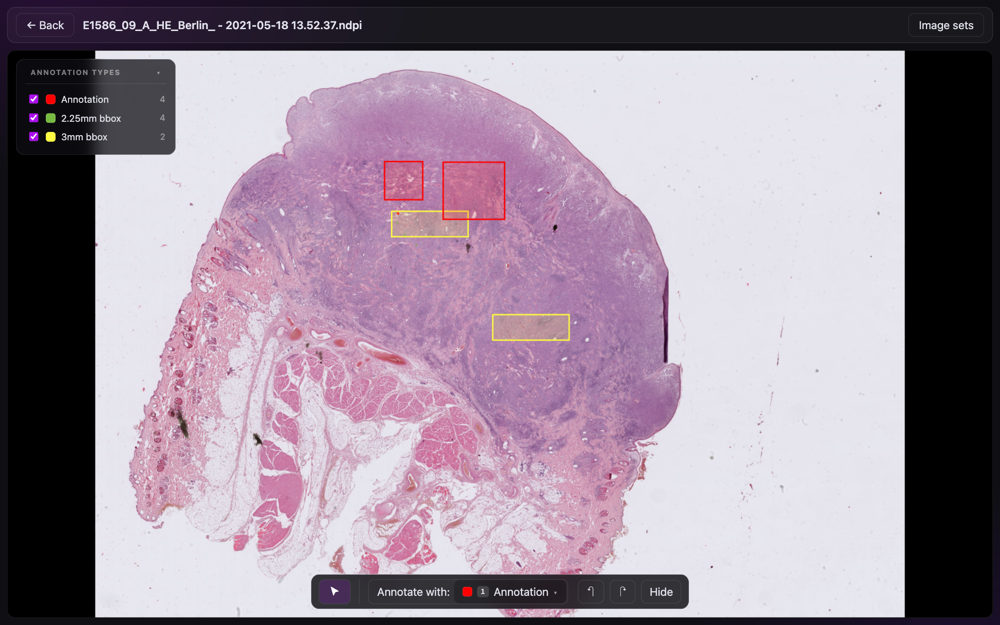
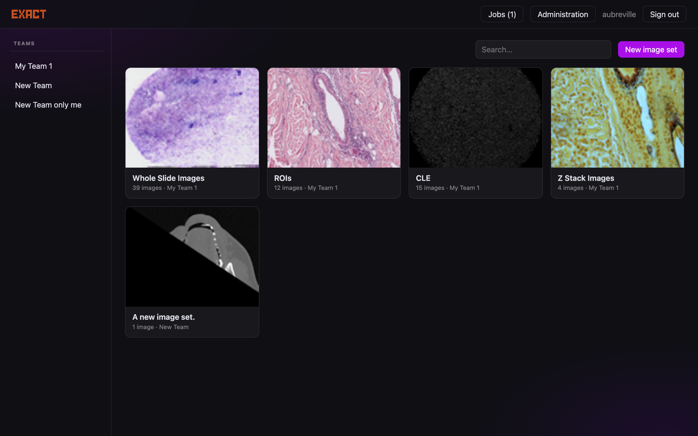
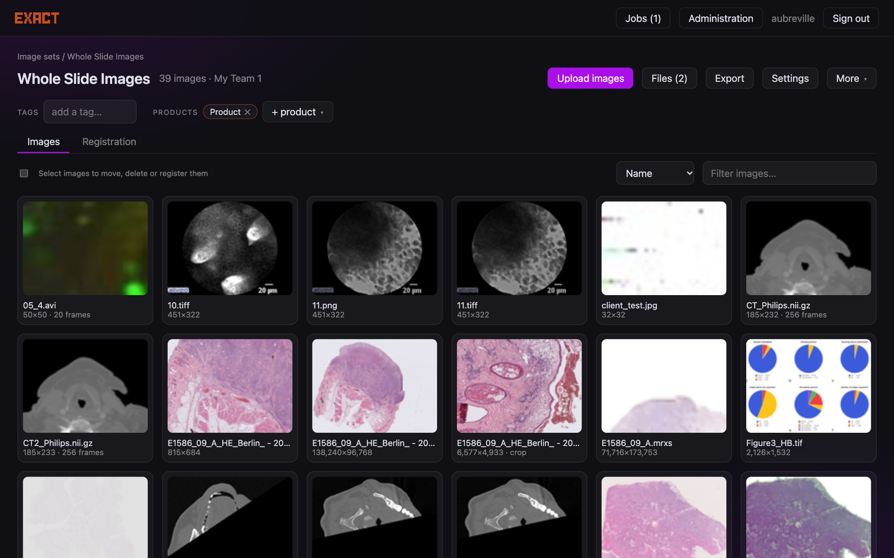
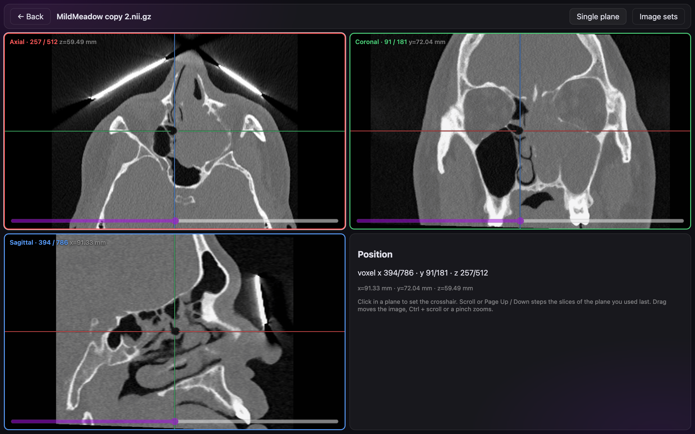
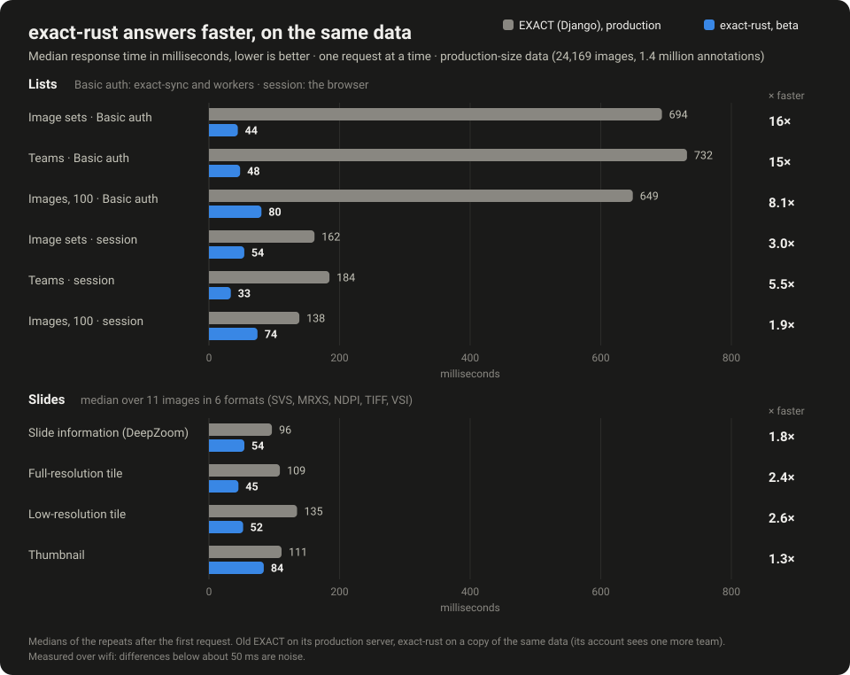

# EXACT-Rust

EXACT-Rust is a port of [EXACT](https://github.com/DeepMicroscopy/Exact), the annotation tool for microscopy images, to Rust:
**one binary plus PostgreSQL**, a new browser interface, and the same REST interface for
[exact-sync](https://github.com/DeepMicroscopy/EXACT-Sync) and machine-learning workers.

It runs against an existing EXACT (Django) database. The only changes are additive tables and columns, so Django can be
started again at any time.

## What it does

| | |
|---|---|
| **Look at anything** | Whole-slide formats (OpenSlide), TIFF and BigTIFF, OME-TIFF z-stacks, NIfTI and DICOM volumes with a three-plane view, movies, CZI and VSI. Damaged TIFF pyramids can be repaired in place. |
| **Annotate quickly** | Click an annotation to select and edit it. The toolbox follows what is selected. One-click mode places fixed-size boxes. Polygons have a brush (add / erase area) and a knife (split). All old keyboard shortcuts work. |
| **Work in teams** | Teams, image sets, products and annotation types, invitations by link, passkeys or passwords. |
| **Register images** | Manual and automatic registration of image pairs, with a review of the result and overlays in the viewer. |
| **Run analyses** | Plugins and workers: a job queue with an atomic claim, progress and results back as annotations. |
| **Stay compatible** | `/api/v1` answers like the Django version, so exact-sync and existing notebooks keep working. `/api/v2` is the new interface. |

## Speed

Median response times of the same read-only requests, one at a time, on production-size data (24,169 images, 1.4 million annotations): exact-rust is 1.3 to 16 times faster than
the Django version, most for the lists that exact-sync and workers ask for (Django checks the password on every Basic-auth request). How it was measured, and the numbers, are in the
[README](https://github.com/DeepMicroscopy/Exact-Rust#speed).

## Where to go next

* **Using it:** [User guide](user-guide) and [keyboard shortcuts](shortcuts).
* **Running a team:** [Administration](administration).
* **Installing it:** [Beta installation on a copy of production](DEPLOY).
* **Scripting it:** [API](api) and the [QueueRunner claim](queuerunner-v2).
* **How it is built:** [Architecture](architecture).
