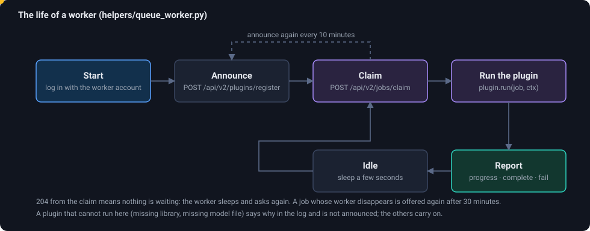

# Plugins and workers

EXACT-Rust does no machine learning and no heavy image computation itself. Anything of that kind is done by a **worker**: a separate program, usually Python, that can run on the same machine or on a GPU server elsewhere.
A worker bundles one or more **plugins**. This page explains the roles, the protocol and what ships with the server; [How to write a plugin](howto-plugin) is the tutorial.

<figure class="diagram"><figcaption>The loop every worker runs. The dot is one pass: announce, claim, run, report, wait.</figcaption></figure>

## Three kinds

| | **Registration plugin** | **Image analysis plugin** | **Segmenter** |
|---|---|---|---|
| Question it answers | How do two images line up? | What is in this image? (detections, a heat map) | Which voxels of this volume belong to a structure? |
| Input | two image files | one image file | the voxels of a volume, over HTTP |
| Output | a 3×3 matrix (+ error, + optional extra file) | detections stored as annotations with a score | a mask in a mask annotation |
| Announced with | `POST /api/v2/plugins/register` (`plugin_type` 2) | `POST /api/v2/plugins/register` (`plugin_type` 1) | `POST /api/v2/segmenters/register` |
| Jobs claimed with | `POST /api/v2/jobs/claim` (`kinds: ["registration"]`) | `POST /api/v2/jobs/claim` (`kinds: ["plugin"]`) | `POST /api/v2/segmentation-jobs/claim` |
| Done with | `/registration-jobs/{id}/complete` | `/plugin-jobs/{id}/complete` | `PUT /api/v2/segmentation/{annotation}/labels` |
| Started by | *Register* in the web interface, `POST /images/{id}/register`, exact-sync | `POST /api/v2/plugin-jobs`, exact-sync, QueueRunner's clients | *Auto segment* in the three-plane view |
| Program | `helpers/queue_worker.py` | `helpers/queue_worker.py` | `helpers/segment_worker.py` |
| Written as | a class in `helpers/plugins/*.py` | a class in `helpers/plugins/*.py` | a module in `helpers/segmenters/` |

The first two share one worker program and one plugin interface (`helpers/queue_plugin.py`); the segmenter has its own, smaller one because it never touches image files.

## What a worker needs

* **An account** that logs in like a user. The permissions: `processing.add_plugin` (to announce), `processing.change_pluginjob` (to claim and report), and for registration plugins `images.change_imageregistration`. *Administration → Users → New worker account…* creates one with the right set and shows the two env lines (`WORKER_USER`, `WORKER_PASSWORD`) once.
* **Membership in the teams it serves.** A worker is offered jobs for the images of its own teams only.
* **Access to the image files**, under the same paths as the server (the jobs carry absolute paths), read-only is enough. Or, for segmenters, nothing: the voxels come over HTTP.
* **The Python it needs** (the container image has numpy, OpenCV, PyTorch with CUDA, slideio, qt-wsi-registration, DeeperHistReg).

Several workers can run side by side. The claim is atomic, so a job goes to exactly one; a job whose worker goes silent for 30 minutes is offered again. The Jobs page shows whether any worker has asked for work lately, so users see why a queued job does not move. **A plugin whose worker has not been seen for 7 days is not offered**: not in the viewer's *Analysis* panel, not in the *Register* dialog (and not as the default registration plugin), and an analysis of it cannot be started. "Seen" means the worker announced the plugin, asked for its jobs, sent a heartbeat or took a job (QueueRunner counts through its jobs). Starting the worker again makes the plugin appear again within seconds. A worker that is busy with a long job sends a heartbeat (`POST /api/v2/jobs/heartbeat`) every 20 seconds, so it stays listed (and its plugins stay *served*) while it computes.

## The plugin interface in short

A plugin is a Python class with a **name**, a list of **parameters** and one method. The server never imports it: the worker announces the name and parameter schema, so the web interface can build the form.

```python
class MyPlugin(ImageAnalysisPlugin):
    name = "My detector"
    package = "org.example.my-detector"      # unique id, also tells two plugins of one name apart
    parameters = [param("threshold", "float", 0.5, "Threshold", "Detections below are dropped.", min=0, max=1, step=0.05)]
    def unavailable(self): ...               # why it cannot run here (library, model file missing), or None
    def analyze(self, image_path, params, ctx): ...   # returns AnalysisResult(detections, "annotation type name", ...)
```

**Parameter types** are `int`, `float`, `bool`, `text` and `choice` (with `choices=[...]`); `min`, `max`, `step`, `help` and `label` shape the form. The server checks a registration job's values against the schema and refuses unknown names.
(An analysis started from the viewer's *Analysis* panel carries the values chosen there in `params`; a job created by `POST /api/v2/plugin-jobs` carries none, so the plugin's defaults decide.)

`ctx` is what a plugin may need besides the job: `ctx.log(text)`, `ctx.progress(percent)` (shown on the Jobs page) and `ctx.exact_dir` (see below). `open_slide(path, ctx.exact_dir)` from `plugins_common` gives a slide object with `dimensions`, `level_dimensions`, `level_downsamples` and `read_region(location, level, size)`, whichever format the file has.

If a plugin raises, the worker reports the traceback to the server as the job's error; the job shows as *failed* with the text, and can be restarted from the Jobs page.

## What ships

### Registration

| Plugin | What it does | Needs |
|---|---|---|
| **Quad-tree SIFT registration** (`qt_wsi_registration.py`) | The algorithm of EXACT's `ImageRegistration.perform_registration`: SIFT features on a quad tree of tiles. Result: a homography and the pickled tree (so points convert piecewise). Parameters: features per tile, match ratio, cross check, FLANN, grayscale, homography, outlier filter, tree depth, thumbnail size. | `pip install qt-wsi-registration` |
| **DeeperHistReg** (`deeperhistreg_plugin.py`) | The method that won ACROBAT 2023: SIFT and SuperPoint/SuperGlue matching for a rigid or affine alignment; *Mode: deformable* adds a non-rigid registration. It first cuts out the tissue (the *Overview size*, 4096 px by default) so scans that are mostly glass keep their resolution. Result: the best homography **and** the full deformation, which the server uses to convert points. | `pip install deeperhistreg` (with PyTorch); a GPU for deformable registration of large slides |
| **Multi-stage registration (features + refinement)** (`multistage_registration.py`) | For **exact** matrices. A feature based rough alignment (DeeperHistReg when installed, else SIFT) is refined on the slides themselves: a pyramid of ECC steps on stain-independent structure images, then phase correlation of tiles over the tissue, then of patches at nearly full resolution (16, 8, 4 slide pixels per pixel) with a robust affine fit, a few recursions each. A step is kept only if the two slides then agree better. Result: the affine matrix; the error is the shift that the patches still show, in target pixels. **When the pair already has a DeeperHistReg registration** (it was the last one made for the pair, in either direction; the reverse one is inverted), the plugin starts from its matrix and skips the rough alignment, which saves most of the time (switch off with *Reuse DeeperHistReg*). Parameters: rough method, *Reuse DeeperHistReg*, DeeperHistReg's settings, *Refine*, *Refinement resolution*, *Tile size*, *Recursions*. | `opencv-python-headless`, `numpy`, `pillow`; `deeperhistreg` (optional, better rough alignment) |

How registration works and how to use it: [the HOWTO](howto-registration).

### Image analysis: the MIDOG 2025 baseline detector

<figure class="diagram"><figcaption>The detector as a plugin: tissue patches light up one after another, detections appear, and one request stores them.</figcaption></figure>

`helpers/plugins/midog2025_fcos.py` is a port of the reference algorithm of the MIDOG 2025 challenge (an FCOS detector with a ResNeXt-50 backbone) to run on the same server as a worker plugin. It finds **mitotic figures** and stores them as boxes with a score.

1. A **tissue mask** is computed on a thumbnail (Otsu threshold, closing) so empty glass is skipped.
2. The tissue is cut into **1024 px patches at full resolution** with 30 % overlap. Patches are read by background threads, ahead of the model.
3. **FCOS** runs on the patches in batches (on the GPU when there is one).
4. One **non-maximum suppression** merges the detections of overlapping patches (IoU 0.3).
5. The result is stored in **one request** (`POST /api/v2/plugin-jobs/{id}/complete`): an entry *Mitotic Figures* with the detections as annotations with a score, default threshold 0.548 (the reference's).

Differences to the QueueRunner plugin it comes from: the model is loaded once and kept; no PyTorch Lightning; the image is read directly instead of downloaded; patches that border clipping produced twice are run once; images without a pyramid or smaller than a patch work; only the mitotic figure class is stored. On the three demo images the detections and scores are identical to the reference.

Setup: the checkpoint `FCOS_x50.ckpt` (373 MB, not in the repository) in the folder `MODELS_PATH`, mounted at `/models`; the worker account needs membership in the teams, and the image set a type with *mitotic figure* in its name (the job fails with "Missing annotation type" otherwise). Details in [Installation §4e](DEPLOY#4e-mitotic-figure-detection-midog-2025-baseline).

**Seeing and starting it in the viewer.** The robot button in the viewer's top bar opens the *Analysis* panel: the results this image has (tick one to draw its detections over the image, move the slider to choose the score threshold and see how many remain) and the plugins available for the image set, each with a **Run** button and its parameters. See [UI and workflow](ui-workflow#analysis-plugin-results-in-the-viewer).

### Segmenters

`helpers/segment_worker.py` serves *Auto segment* in the three-plane view. A segmenter is a module in `helpers/segmenters/` with `NAME`, `DESCRIPTION`, `PARAMS` and `segment(volume, spacing_mm, params, progress)` that returns a mask. **`threshold.py`** ships (Otsu or fixed bounds, closing, holes filled, largest part kept); **`nnunet_example.py`** is a documented skeleton for nnU-Net, MONAI or TotalSegmentator with a model you provide. No trained model ships. Setup and the account: [Administration → Workers](administration#segmentation-worker).

## Where the worker finds the images

The server puts the **absolute path of the file** into the job it hands out (`image_path`, or `source_path` and `target_path`), so a worker must see the image store under the same path as the server. The container compose file mounts it read-only at `/data/images` in both.
With `--exact-dir` (the container has it) the worker uses EXACT's own slide readers and so reads every format EXACT reads; without it, OpenSlide. See [file formats](file-formats#workers-and-formats).

## Compatibility with QueueRunner

The old `EXACT-QueueRunner` runs against `/api/v1` unchanged: it lists jobs, claims by PATCHing `attached_worker`, creates plugins, results, entries and annotations one request each. The server answers all of it as Django does. The v2 claim is a one-request improvement without the race; see [QueueRunner and the v2 claim](queuerunner-v2). New plugins should use `helpers/queue_worker.py`: it needs no `exact-sync`, uploads results in one transaction and shares the code with the registration plugins.

## What was dropped

The Django version also had **in-process server plugins** (`ExactServerPlugin`, `pluginFinder`, the navigator policies that used them): Python code loaded into the web server. They are not ported: a plugin that crashes or hangs must not take the server down, and the Rust server has no Python in its process. Their job is what workers do now.
