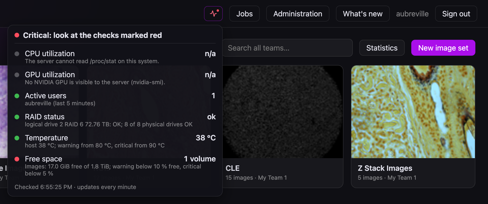

# System health
Site admins have a **pulse icon** in the top bar, next to *Jobs*. It answers one question: *does the server need attention?*



- **The icon is quiet while everything is fine.** A yellow dot appears when a check is in *warning*, a red dot when one is *critical*.
- **Hover** it for the storage: used, free and total space of every volume, e.g. `Images: 54.2 TiB used, 18.5 TiB free of 72.8 TiB (75 % used)`.
- **Click** it for the list of checks, each with its value and status, and the overall status at the top. The list reloads when it
  opens and the icon refreshes itself every minute.

Only site admins see the icon; for everybody else `GET /api/v2/health` answers 403.

## The checks

| Check | Where the value comes from | Alarm |
|---|---|---|
| **CPU utilization** | `/proc/stat`: all cores, sampled over 0.3 s | warning from 85 %, critical from 95 % |
| **GPU utilization** | `nvidia-smi` inside the server container (load, memory and temperature of every GPU) | none; shown for information, its temperature counts as a temperature |
| **Active users** | everybody whose browser or API token (exact-sync) made a request in the last 5 minutes, with their names | none |
| **RAID status** | the status file the host writes (see below) | *degraded* or *rebuilding* array, a drive with a predicted failure: warning. A failed drive, array or controller: critical. A status file that is older than 15 minutes: warning |
| **Temperature** | the hottest of: the sensors in `/sys/class/hwmon`, the GPU, and `temperature_c` of the host's status file (iLO/IPMI) | warning from 80 °C, critical from 90 °C |
| **Free space** | the volumes of the image store, the media files and the cache (a volume shared by two of them is listed once) | warning below 10 % free, critical below 5 % free |

The overall status is the worst of the checks.

Some details:

- A check the server **cannot read** (no GPU in the machine, no sensors visible, the host script not installed yet) is shown grey as
  *n/a* and is **never an alert**. The icon only turns on for something that is actually wrong.
- The list of **active users** lives in the server's memory: after a restart it starts empty and fills as people work. The accounts of
  the registration and segmentation workers (they log in with basic authentication) are not counted.
- The **CPU** and **sensor** readings are those of the host, not of the container: `/proc` and `/sys` show the whole machine.

## Setting it up
CPU, memory, storage, GPU and sensors need nothing but the container. Compose already hands the server what it needs: the GPU
with the `utility` capability only (enough for `nvidia-smi`, no compute) and a read-only folder for the host's status file.
Without a GPU in the machine start with `-f deploy/docker-compose.cpu.yml`; the GPU row then reads *n/a*.

**The RAID** is the one thing a container cannot see, so a small script on the host looks it up and leaves the result in a file.

1. **Install the controller's tool on the host.** For an HPE Smart Array (a ProLiant DL380, say) that is `ssacli`, from HPE's
   Management Component Pack (package `ssacli`). Check that it works, it needs root:
   ```
   sudo ssacli ctrl all show config
   sudo ssacli ctrl all show status
   ```
   Other controllers: `storcli64` (Broadcom/LSI MegaRAID) and Linux software RAID (`/proc/mdstat`) work as well; the script uses the first it
   finds. For the temperature of the machine (iLO / IPMI) install `ipmitool`; without it the server reads the sensors it sees itself.
2. **Try the script by hand** (it is in the repository, `deploy/host-status.py`, and needs Python 3):
   ```
   sudo python3 /opt/exact-rust/deploy/host-status.py /var/lib/exact-host-status/status.json
   cat /var/lib/exact-host-status/status.json
   ```
   You should see something like
   `{"raid": {"status": "ok", "detail": "logical drive 2 RAID 6 72.76 TB: OK; 8 of 8 physical drives OK"}, "temperature_c": 38.0}`.
3. **Run it every five minutes from root's crontab** (`sudo crontab -e`):
   ```
   */5 * * * * /usr/bin/python3 /opt/exact-rust/deploy/host-status.py /var/lib/exact-host-status/status.json
   ```
   (Use your path to the repository.) The file is replaced atomically and readable by everybody, so the container's user can read it
   even with rootless Docker.
4. **Tell compose where the folder is**: `HOST_STATUS_DIR=/var/lib/exact-host-status` in `deploy/exact.env` (the default is
   `./host-status` next to the compose file, which stays empty), then `dc up -d`. After the next cron run the RAID row shows the state.

If the cron job stops, the file gets old and the RAID row turns to a warning after 15 minutes: a silent monitor is not a healthy one.

### How the RAID is judged (HPE Smart Array)
| What `ssacli` reports | Status |
|---|---|
| every logical and physical drive `OK` | ok |
| a logical drive *Recovering*, *Rebuilding*, *Interim Recovery Mode*; a physical drive *Predictive Failure*; battery/capacitor not OK | warning |
| a logical drive *Failed*; a failed physical drive; the controller not OK | critical |
| cache *Permanently Disabled* | ignored: the controller has no cache module built in, that is how the machine is |
| drives that belong to no array (*Unassigned*) | ignored |

Anything the script does not know counts as a warning, so a new status word is seen rather than swallowed.

### The status file
If your RAID needs another tool, write the file yourself from any script; the server only reads this JSON (both parts are optional):
```json
{"raid": {"status": "ok", "detail": "free text shown in the popup"}, "temperature_c": 41.5}
```
`status` is `ok`, `warning`, `critical` or `unknown`. The path is `EXACT_HOST_STATUS_FILE` (set by compose to `/data/host-status/status.json`).
A file that does not exist yet is *n/a*; one that exists but cannot be read, or is not JSON, is a warning with the reason.

## Troubleshooting
| What you see | Likely cause |
|---|---|
| No icon | the account is not a site admin; or the server is older than this feature |
| RAID *n/a*, "Not set up" | the status file does not exist: cron has not run, or `HOST_STATUS_DIR` points to another folder than the script writes to |
| RAID *unknown*, "no RAID tool found" | the script ran as a user without access to the controller, or the tool is not installed; cron needs root (its `PATH` is added by the script) |
| RAID warning, "not updated for N minutes" | the cron job stopped or fails: run the script by hand and read its error |
| GPU *n/a* although the machine has one | the server container does not have the GPU: compose file without the reservation, or the NVIDIA Container Toolkit is missing (see [Installation](DEPLOY.html), section 4c) |
| Temperature *n/a* | no sensor is visible in `/sys/class/hwmon` (virtual machines, some servers): install `ipmitool` on the host so that the script can report it |
| Free space shows a volume you did not expect | the image store, media and cache each live on a volume of their own; they are listed by file system |

## The interface
`GET /api/v2/health` (site admins) answers
```json
{"status": "ok|warning|critical", "checked_at": "...", "active_users": ["anna"],
 "checks":  [{"id": "cpu", "name": "CPU utilization", "status": "ok", "value": "12 %", "detail": "..."}, ...],
 "storage": [{"name": "Images", "path": "/data/images", "total": 0, "free": 0, "used": 0, "status": "ok"}]}
```
Check ids are `cpu`, `gpu`, `users`, `raid`, `temperature` and `storage`; `status` of a check is `ok`, `warning`, `critical` or
`unknown`. It is cheap enough to poll from a monitoring system: alert on `status != "ok"`.
