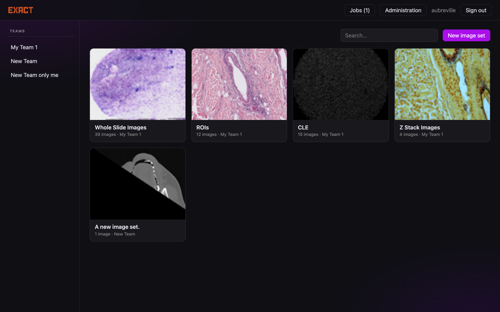
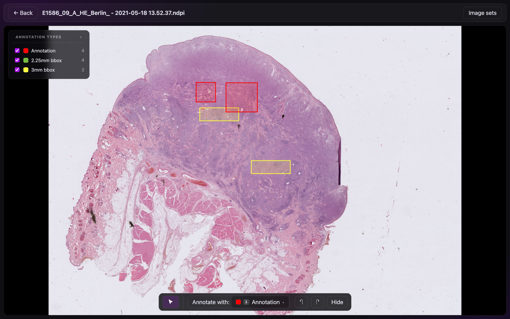

# The web interface and how people work with it

The interface is a single-page application (React, TypeScript, OpenSeadragon). It was designed for **pathologists who annotate a lot**, on a desktop with a mouse, on a tablet with a pen, and, for viewing, on a phone. The old EXACT interface was the starting point for what people can do, not for how it looks: every old keyboard shortcut still works, and the rest was rethought around four ideas.

| Idea | What it means in practice |
|---|---|
| **Click to select, and a selected annotation is editable** | No separate "edit mode": click an annotation to move it, drag a handle to resize it, edit polygon area with a brush. |
| **The toolbox follows the context** | It shows what you can do *now*: draw types when nothing is selected, edit tools when something is, shape hints while drawing. |
| **One-click runs** | In *one-click mode* each click places an annotation of the type's fixed size: counting cells is one click per cell. |
| **Every input is a pointer** | Mouse, pen and finger arrive as pointer events and behave alike; touch targets are large; the pen annotates without switching a tool on. |

## The screens

<figure class="diagram"><figcaption>The screens, and a typical visit: log in, pick an image set, open an image. The top bar is on every screen.</figcaption></figure>

| Screen | Address | What you do there |
|---|---|---|
| **Login** | `/` | Sign in with a user name and password, or with a **passkey** (fingerprint, security key). New users arrive through an **invitation link** (`/invite/<token>`) and choose their user name and password. |
| **Image sets** | `/` | The image sets of your teams. Pick a team on the left, search by name, **New image set**, and **Statistics** for a team (images, annotations, storage per set and file format). More sets load as you scroll. |
| **Image set** | `/sets/{id}` | Thumbnails of the images. Upload by drag and drop, filter and sort, select several to move, delete, download or register. Right click (long press on a tablet) for an image's menu: open, download, rename, move, related images. **Settings**, **Export**, **Files**. The **Registration** tab lists registrations and their jobs. |
| **Viewer** | `/images/{id}` | Look at and annotate one image. Left panel: annotation types with counts (untick to hide). Bottom: the toolbox. Top bar: previous / next image, overlay, screening, screenshot, **analysis (robot button)**, crop, image adjustments. |
| **Three planes** | `/images/{id}/planes` | NIfTI and DICOM volumes: axial, coronal and sagittal planes with a crosshair, a 3D render, and 3D segmentation tools. |
| **Jobs** | `/jobs` | Registrations, analyses and segmentations with their status (queued, running with progress, done, failed with the error). Restart failed jobs, cancel queued or running ones. Shows whether a worker has asked for work lately. |
| **Administration** | `/admin` | Teams, Products (annotation types), Plugins, Log, Users (for administrators). See [Administration](administration). |
| **Preferences** | `/preferences` | Email, password, **passkeys**, slide navigation, overlays, an optional **zoom slider**, zoom step of the `+`/`-` keys, **allow annotations outside the image**. |

The **pulse icon** in the top bar (site admins) shows system health; the **?** opens help with the keyboard, the mouse and trackpad gestures; **What's new** repeats the welcome tour.

## The viewer in detail

### States

<figure class="diagram"><figcaption>The three states of the viewer and the way between them; the dot walks one round.</figcaption></figure>

### Drawing and editing

| Shape | How |
|---|---|
| Box, line | drag |
| Point, fixed-size box | click (a ghost outline shows the size) |
| Polygon, polyline | drag around the shape; lifting near the start closes it. Or click the corners; click the first point to close. `Enter` finishes an open one |
| Polygon edit | select, then `Shift` + drag **adds** area with a brush, `Alt` + drag **erases**, `D` cuts along a line (knife) |
| Many at once | `Ctrl+A` all, `Ctrl+C` / `Ctrl+V` copy and paste, `Delete` removes |
| Undo | `Ctrl+Z`, redo `Ctrl+Shift+Z` |

While you draw, the area (µm² or mm² when the image has a resolution) or the length is shown on the shape. Moving the slide while drawing: `Shift` + drag, `Space` + drag, the middle mouse button, or a finger.

**Annotations outside the image.** Points are held at the edge of the image by default, which makes drawing along the border easy. If you need coordinates below 0 or beyond the size of the image (for example to mark a structure that is cut off by the scan), switch on *Allow annotations outside the image* in *Preferences → Viewer*: boxes, lines, polygons and points can then be drawn, dragged and pasted past the edge and keep their negative or too large coordinates. The API never restricted them: `POST /api/v2/annotations` and `/api/v1/annotations/annotations/` store whatever integers they get.

### Tools for looking

* **Navigation** is a preference: *Trackpad / tablet-optimized* (pinch to zoom, two fingers pan) or *Mouse-optimized* (click zooms in, `Shift` + click out), as in the old EXACT.
* **Zoom:** scroll or pinch; `+` and `-` zoom in steps you choose (low, medium, high); an optional **zoom slider** shows the zoom in percent with a `100 %` button; the **scale bar** follows when the image has a resolution.
* **Image adjustments** (round icon): brightness, contrast, gamma, saturation, hue, grayscale, invert. Only the display changes, never the file or the annotations.
* **Overlay** of a registered image with an opacity slider (`O` toggles it): see [registration](howto-registration).
* **Frames:** z-stacks and movies get a slider (`Shift+E` / `Shift+Q`, `Space` plays).
* **Screening:** a guided walk over the slide in windows of a size and overlap you choose, remembering what you have seen (WASD steps and counts, IJKL steps without counting).
* **Screenshot** saves the view as a PNG with annotations and adjustments; **Crop to new image** cuts a region into a new image that remembers where it came from.

### Analysis: plugin results in the viewer

The **robot button** in the top bar (a dot on it says that the image has results) opens the movable *Analysis* panel:

* **Results for this image**: every result a plugin calculated, with its entries. Tick an entry to draw its detections over the image; the slider sets the **score threshold** (it starts at the plugin's default) and the panel counts how many detections remain. Tens of thousands of detections stay fast, and detections too small to see at the current zoom are drawn as small squares.
* **Run an analysis**: every analysis plugin that is available for the image set (a plugin that names no products is available everywhere; one that names products must share one with the set). *Parameters* opens the plugin's form; **Run** queues the job. The panel shows *waiting for a worker* (and says so when no worker has asked for that plugin lately), the progress while it runs, the error when it fails (**Run again**), and the new result as soon as it is stored.

Closing the panel keeps the detections on the image; changing the image clears them. Starting an analysis needs only membership in the team that owns the image set.

### Volumes

NIfTI and DICOM volumes open in the **three-plane view**, with a crosshair, a 3D render and the **Segment** tools: brush, lasso and wand, interpolate between slices, grow and shrink, undo and redo, and an optional **automatic segmentation** by a worker. Segmentations made elsewhere (3D Slicer `.seg.nrrd`) can be linked to a volume and shown over its planes. Details in the [user guide](user-guide#3d-segmentation).

## Devices

| | Annotating | Viewing |
|---|---|---|
| **Desktop** (mouse, keyboard) | full: shortcuts, brushes, one-click runs | yes |
| **Tablet** (finger, Apple Pencil) | yes: the pen draws without a tool switch and acts as a polygon brush; two round buttons near the thumb switch add / subtract and set the brush size; a finger pans and zooms, a tap selects | yes |
| **Phone** | not designed for it | yes: browse, zoom, review |

Text in the interface cannot be selected by a long press on touch screens, so a long press is a gesture (the context menu), not an accident. A page does not reload when you scroll past the end of a list.

## Four typical journeys

| You are | Your path |
|---|---|
| **A pathologist annotating** | Login → pick the image set → open an image → press the number key of a type → click or draw → `E` next image. Use `Y` to hide annotations, `O` for the overlay of the neighbouring stain, `?` for help. |
| **A study coordinator** | [Create the team](howto-team), invite colleagues, define annotation types in a product, create an image set with that product, upload, check progress in the counts, **Export**. |
| **A data scientist** | Create a worker or personal token, read annotations with the [API](api) or exact-sync, write a [plugin](howto-plugin) that stores detections back, and review them with the team. |
| **An administrator** | Create worker accounts, watch **Jobs** and *Administration → Log*, read the system health icon, check [Installation](DEPLOY) and [Running next to Django](coexistence). |

## What it does to protect your work

* **Edits conflict, they do not overwrite.** The editing API is conditional: if a colleague changed the same annotation meanwhile, the server refuses the change (409) and returns the current version instead of silently overwriting it.
* **Deleting through the API is soft first:** a deleted annotation can be restored until it is hard-deleted.
* **Verification** is a separate act by a second person; saving an annotation never verifies it.
* **Read-only accounts** see everything their teams give them and can change nothing, whichever way they sign in; the interface hides the buttons that would fail.
* **Your settings follow you**: navigation, overlay defaults, zoom and the image adjustments are remembered per account or per browser.

More about each feature: [User guide](user-guide) · all keys: [Keyboard shortcuts](shortcuts).
