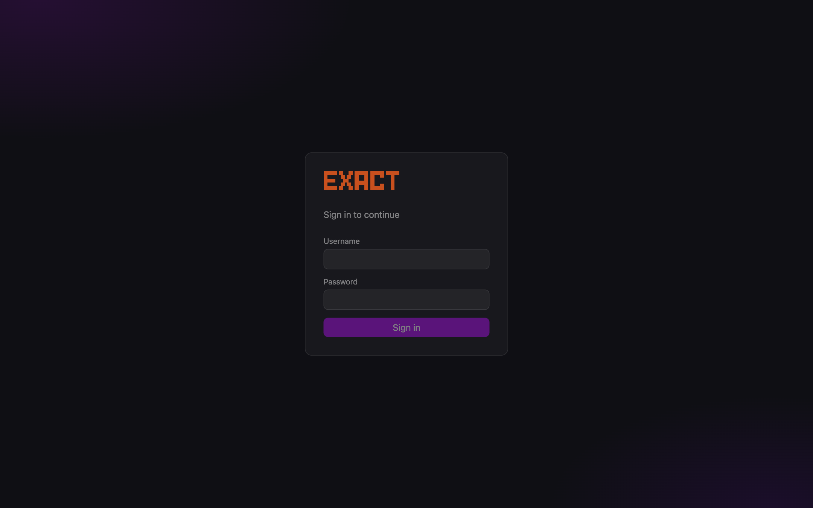
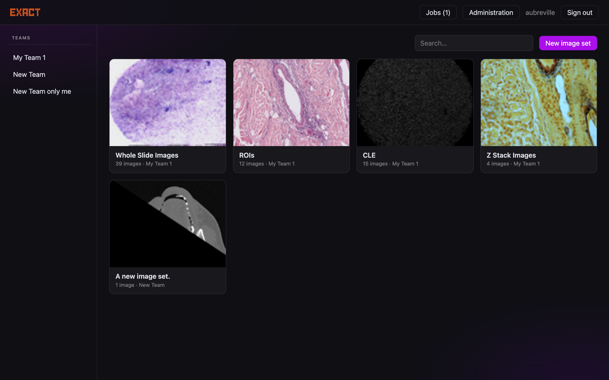
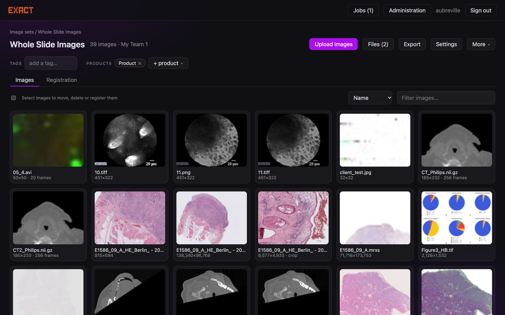
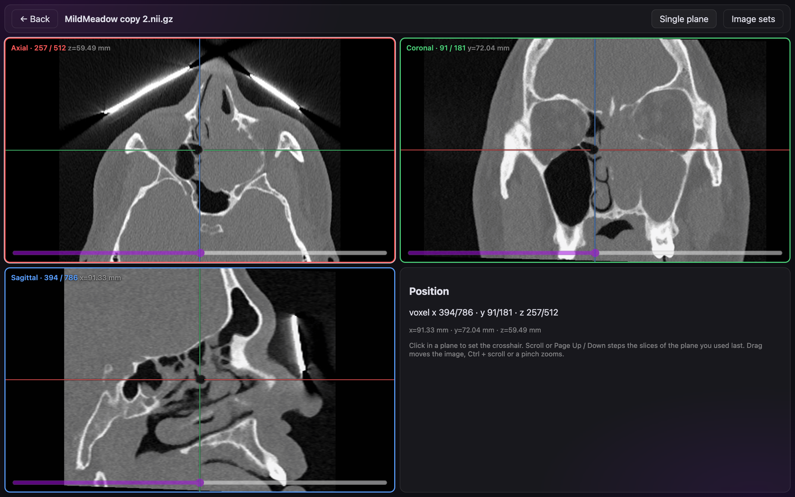
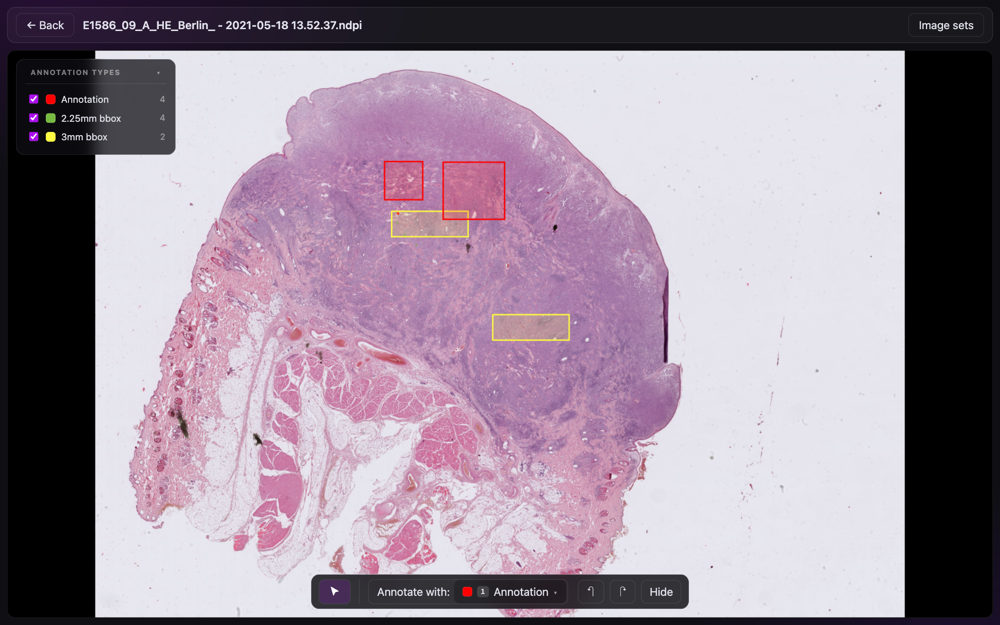

# User guide

## Welcome
The first time you sign in, a short tour of four pages shows what is better than the EXACT you know: how much faster it is, that it works on every device, the Apple Pencil on the iPad, and the annotation tools. Skip it or step through with Next, Back or the arrow keys; you can see it again any time under **What's new** in the top bar.

## Signing in
Sign in with your user name and password. (The server also supports passkeys; enrolling and using them in the interface is
not built yet.) New users receive an
**invitation link** from a team administrator; opening it lets you choose a user name and password.

## Image sets
The start page lists the image sets of your teams. Pick a team on the left to narrow the list, or search by name; with a team
selected, **Statistics** shows images, annotations and storage per image set and file format.
An image set holds images, tags and *products*; the products decide which annotation types you can use in it.

Inside an image set you can:

* **Upload images** by dragging files onto the page. Each upload becomes a card with progress. When a name already exists
  you are asked whether to keep both, replace, or skip.
* **Filter and sort** the thumbnails, or select several to move, delete or register them.
* **Right-click an image** (on a tablet or phone: press and hold) for its menu: **Open**, **Download** (the original file; slides
  that consist of a folder, such as MRXS and VSI, come as a ZIP that is packed first, so the download starts after a moment),
  **Rename…** (the name of the image; the file extension has to stay, and z-stacks, frame series, MRXS and VSI slides cannot be renamed),
  **Move…** (no selection needed; on a selected image it moves the whole selection) and **Related images**: the images it was
  registered with and the crops made from it, or the image it was cropped from. Click one to open it.
* **Download several images:** select them (checkboxes) and press **Download** in the toolbar: the original files come as one ZIP file.
* **Export** the annotations in one of the export formats of the set, **view statistics**, and open **Files** (auxiliary
  files such as reports).
* Open **Settings** to rename the set, change its team, tags and products.

## The viewer
Click a thumbnail to open an image. Drag to pan, scroll to zoom. The left panel lists the annotation types with their counts;
untick a type to hide it. **Hide** (or `Y`) hides all annotations.

**Slide navigation (a personal setting).** Under your user name (top right) → **Preferences** → *Slide navigation* you choose between **Trackpad / tablet-optimized** (the default: pinch to zoom, two fingers move the slide, a drag on the background draws a selection frame) and **Mouse-optimized**, the navigation of the old EXACT: a click on the background zooms in about the pointer, **Shift** + click zooms out, and a drag on the background always moves the slide (Ctrl / Cmd + drag still frames annotations). Both come with a small animation. A click on an annotation still selects it, and drawing tools work as before. The mouse mode applies to a mouse only; a tap of a finger or pen never zooms, so that tablets are not affected.

**User menu and Preferences.** The user name in the top bar opens a short menu: **Preferences**, **User statistics** (your annotations, uploaded images and verifications, per team and per day for the last 30 days) and **Sign out**. Preferences holds your email address, a password change (other devices are signed out), your passkeys (add, rename, remove; the login page then offers *Sign in with a passkey*) and the slide navigation.

The round icon at the right of the top bar opens **Image adjustments**: brightness, contrast, gamma, saturation, hue, grayscale
and invert. The window can be moved by its title (and stays where you put it), double-clicking a slider's name resets it, and a dot
on the icon shows that something is changed. Only the display changes: not the file, not the annotations, and a crop or
download is unaffected. Your settings are remembered for the next image.

### Frames, volumes and movies
* **Z-stacks and movies** get a frame slider; `Shift+E` / `Shift+Q` or `Page Up` / `Page Down` step through frames, `Space`
  plays a movie (right click on the play button chooses the speed).
* **NIfTI and DICOM volumes** open in a **three-plane view** (axial, coronal, sagittal) with a crosshair. Click in a plane to
  move it, scroll to zoom (**Shift** + scroll steps through the slices; the button **Wheel: zoom / slices** in the top bar swaps the two, and the choice is remembered). *Single plane* switches back to the ordinary viewer.

The fourth panel can show a **3D render** of the volume (**Show 3D render**; with a segmentation type chosen, its mask is drawn in the type's colour). It is off
until you ask for it: the server first averages the volume onto a coarse grid (choose *Fast* to *Very fine*), which takes a few seconds for a large image the first
time. Drag to turn it, scroll to zoom; *Bone*, *Soft tissue* and *Maximum intensity* are starting points for the threshold and opacity sliders.

### Images from a crop
When the image has registered images, the crop dialog offers to **crop them as well, at the same place**: the region is carried over through the registration (its bounding box, kept inside the other image), each registered image can be left out, and each one gets its own image set: the same as the first crop, another one, or a new one (registered images that get the same new name share it). Frames are not carried over (the crops of the registered images are of their first frame), and a registered image you may not copy from is reported while the others are made. The crops keep the registration of their images: each crop of a registered image is registered onto the crop of this image (and back), with the registration of the images moved to the origins of the crops, so the crops can be overlaid and used for the registered copy of annotations as the images were. While it works, the dialog lists every step (creating image sets, each crop, each registration) with a circle for waiting, a spinner for the one running, a tick when done and a cross when it failed; after an error, *Back* returns to the choices.

An image created by *Crop to new image* remembers where it came from. The top bar offers **Show in original**, and the
pointer position is shown in both coordinate systems.

## Annotating
The toolbox at the bottom changes with what you are doing.

| You | The toolbox offers |
|---|---|
| nothing selected | the annotation type to draw with (drop-down, or keys `1`–`9`), undo / redo, hide |
| selected an annotation | its type, size (for variable boxes), delete, remove vertex, polygon tools |
| are drawing | hints for the shape, `Enter` to finish, `Esc` to cancel |

* **Select** an annotation by clicking it. Drag a handle to resize, drag the body to move. Dragging anywhere else pans.
* **Draw** by dragging (boxes, lines), clicking (points, fixed-size boxes), or outlining (polygons and polylines): **drag around
  the shape** with the pen or mouse, and lifting near where you started closes and saves the polygon. A stroke that ends elsewhere
  stays open: continue with the next stroke or with clicks, and finish with `Enter`, a double click or the *Finish* button.
  Alternatively click the corners one by one (clicking the first point closes a polygon).
* **Move the image while drawing** with `Shift` + drag, `Space` + drag, the middle mouse button or (on a touch screen) a finger.
  A plain drag with the pen or mouse never moves the image while a polygon, polyline, point or one-click box is being drawn.
* **One-click mode** (`A`): every click places an annotation of the type's default size. A ghost outline shows where.
* **Polygons**: select one, hold `Shift` and drag to add area with a brush, `Alt` and drag to erase. `D` splits the polygon along a line
  (knife; it cuts where you drew, as soon as you lift the pen). Scissors and glue of the old EXACT are gone: the brush adds and removes area. On a touch screen use the buttons in the toolbox.
* **Pen**: the pen annotates by itself, without switching a tool on, using the type chosen under *Annotate with*. With a polygon
  type, or a polygon selected, it is a brush: a stroke paints area (Add) or erases it (Subtract). With a polygon selected only
  that polygon is changed. With nothing selected the first polygon the brush touches is the one that is changed, and only for that
  stroke; a stroke that touches nothing makes a new polygon (Add) or does nothing (Subtract). With a box or line type the pen draws
  boxes and lines by dragging. A finger still pans and zooms, and a tap with a finger selects or deselects.
  Once a pen has been used, two round buttons appear at the edge of the screen for the other hand: **+ / −** switches between adding
  and subtracting, and the **ring** shows the brush size and opens a vertical slider (with a button to move the buttons to the other
  side). They are hidden while a rectangle is selected, and a dotted crosshair shows where the pen hovers. A browser cannot see the
  squeeze or double tap of an Apple Pencil, which is why these buttons are on the screen.
* **Several at once**: `Ctrl+A` selects all, `Ctrl+C` / `Ctrl+V` copy and paste, `Delete` removes the selection.
* **Right click** (long press on a touch screen) on an annotation opens its menu: *Info* (who created and edited it, area,
  position), *Change class*, *Crop to new image* and *Delete*.
* While you edit, the **area** (µm² or mm² when the image has a resolution) or the **length** is shown on the shape.
* Everything can be undone with `Ctrl+Z` and redone with `Ctrl+Shift+Z`.

Annotation works on desktop and tablet (touch targets are large, drawing works with a pen); viewing also works on a phone.

## 3D segmentation
In the three-plane view of a volume (NIfTI, and DICOM CT, MR and PET volumes: they work alike) you can paint a **mask** that
belongs to a *segmentation* type, and see and edit it on the axial, coronal and sagittal plane at once. The **Segment** button in the
top bar lists the segmentation types of the image set (marked ▨; the set needs a product that has one). Choosing a type opens the tool window
and lays that type's mask over all three planes; the first use creates the mask in the image. **Escape** or the window's ✕ leaves the mode.

The tools open as a **small palette** (tool, + / −, undo / redo and the size of the brush) that floats over the planes and can be moved
by its top edge. **⤢** opens the whole window with all options (slices, shape, opacity, automatic segmentation), **⤡** collapses it again,
and **⇱** docks the palette in the top bar, where it takes no room from the images (**⧉** floats it again). The choice is remembered.

Each plane has a **⤢** button at its top right: it enlarges that plane to the whole area (the crosshair, tools and slice slider keep working),
and **⤡** brings the three planes back.

Everything is measured in millimetres, so a brush of 8 mm is round in the picture of every plane, also when the slices are thicker than
the pixels. The window can be moved by its title, and it shows the volume of the mask (mm³, from 1000 mm³ in ml) and the number of axial slices
that hold some of it.

* The three tools are shown as icons: **Brush** (`B`), **Lasso** (`L`) and **Wand** (`W`). The round **+ / −** button next to them (or `E`) decides whether the tool
  adds to the mask or subtracts from it; holding **Shift** (or Alt) turns it around for as long as it is held, as with the polygon tools. The **Brush** paints. *2D disc* works in the plane you draw in, one slice thick;
  *3D sphere* reaches through the slices around every point of the stroke. The size is set in pixels of the plane you draw in (the default) or in mm, switched next to the slider; `[` and `]` or Alt + mouse wheel change it.
  With a mouse, pen or finger a drag is one stroke, stored when you lift the pointer; the ring under the pointer shows the size.
* **Lasso** works like a pen that fills what it encircles: draw around an area in one plane and lift the pointer; the outline is closed and the area filled (or taken out with −) in that slice.
* **Wand** adds (or with − removes) the connected region whose grey values are within the *tolerance* of the grey value you click on,
  either in the plane (the default) or through the whole volume. *Reach* limits it to a radius (mm) around the click; a region that is too large is refused with a message.
* **Interpolate slices** fills the empty axial slices between painted ones by blending their shapes. **Copy** repeats the slice of the crosshair
  onto the next or previous slices.
* **Grow** and **Shrink** change the mask by a number of voxels, **Fill holes** closes cavities, **Largest part only** removes the small separate pieces,
  **Clear mask** (click twice) empties it.
* **Undo** and **Redo** (`Ctrl/Cmd+Z`, `Shift+Ctrl/Cmd+Z`) go back and forth through these steps; the steps are kept while the mask is open in the server.
* A click or stroke also moves the crosshair to that point, so the other two planes show it. `Ctrl` (`Cmd`) + click moves the crosshair without painting;
  Shift + mouse wheel (or the wheel, in "Wheel: slices" mode) step through the slices, and so do the keys: `↑` / `↓` for the axial plane (the maximized plane, if there is one), `Shift` + `↑` / `↓` for the coronal and `Alt` + `↑` / `↓` for the sagittal plane, Page Up / Down for the plane used last (the − / + buttons under each plane say so in their tooltip). Accounts that are read-only see the mask and have no tools.

### Several masks at once, and groups
The **Segment** list in the top bar names every segmentation type of the image set; types of a group are listed together under the group's name.

* The **eye** shows or hides the mask of a type on the planes. The type being painted is always shown, **solid**; every other mask you switch on is drawn **striped** (alternating stripes of the type's colour and a darker tone), so
  you can tell at a glance which one the tools change. Without a type chosen, all shown masks are striped (you are only looking). Click a **name** to paint that type (the list stays open when you click an eye, and closes when you pick a type).
* A **group** is a set of segmentation types that exclude each other, for example the organs of one study: *no voxel can be in two masks of a group*.
  Painting a voxel for one type takes it from the others of its group (their striped masks follow at once), and **undo** gives the voxels back to them. Erasing never changes another mask.
  The tool window says which masks the painted type is exclusive with. Types without a group do not interact and may overlap.
  Groups are made in *Administration → Products*: edit a segmentation type and give it a **Group**; types of one product with the same name are in one group.
  Only the voxels the stroke really adds are taken, and a mask that loses voxels this way starts a new undo history (its earlier undo steps would otherwise bring the overlap back).
  Groups apply to volumes; masks of 2D slides are not touched.

The single-plane view of a volume paints masks on the axial plane only; for the other planes its toolbox points to the three-plane view.

## Segmentation files (3D Slicer)
A segmentation made elsewhere, for example in 3D Slicer or TotalSegmentator (a `.seg.nrrd`, or any NRRD label map), can be
**linked to a NIfTI volume** and drawn over it without becoming annotations. Nothing has to exist in EXACT for it: no annotation types, no masks.

1. **Upload** the file into the image set that holds the volume: drop it on the page like an image. A dialog lists the segments in the file
   (name, colour and volume as Slicer stores them) and offers the volumes of the set, the one whose name matches the file's name first
   (Slicer calls the file `<volume> segmentation`); that volume is already chosen. Press **Link**, or **Later**.
2. The file is a **card in the image grid**, next to the images, with a picture of its busiest slice (over the volume's own slice once it is linked) and
   the volume it belongs to. **Click it** to open the three-plane view of its volume; a file that is not linked yet asks for a volume first.
   Right click (long press on a touch screen) opens its menu: open, download, link to another volume, unlink, delete.
3. In the **three-plane view** the **Segmentation** window shows the file: switch the whole file or single segments on and off,
   change the opacity, and read which segment is under the crosshair. The segments are drawn in their own colours on all three planes.
   The volume's **Related images** (right-click the volume in the overview) lists its segmentation files too.
   When several segmentation files are linked to one volume, **only the one you opened is drawn** (the card or the entry in *Related images* opens its own file; the volume opened
   by itself shows the newest). The others are listed in the Segmentation window, unticked: tick one to show it as well.

In the **3D render** (**Show 3D render**) the file has its own **Segmentation** checkbox: every segment is drawn in its colour, and switching segments
off in the Segmentation window changes the render too. The segments usually lie inside the head or body, so switch **Image** off or lower
its opacity (or choose the *Soft tissue* look) to see them.

The orientation of the file does not have to match the volume: both are placed in millimetres, so a segmentation saved with other axes (Slicer
writes LPS and often swaps axes) lands on the same voxels. After linking, EXACT tells you if part of the labelled volume lies outside the
volume; it cannot tell the segmentation of another scan that happens to overlap, so the file name is the check that matters.
**NRRD files that are already images.** A segmentation that was uploaded before segmentation files existed shows as a card marked *segmentation file?* with no picture, and
cannot be opened as an image. Clicking it (or opening its address) asks whether to **convert it to a segmentation file**; then the link dialog opens for the volume. The file is kept,
the image entry goes. A file with annotations, registrations or crops is not converted (the dialog says why), and it needs the right to edit the set and delete its images. The
right-click menu of such a card has the same **Convert to segmentation file…**. Your administrator can convert all of them at once.

**Import as annotations.** The **Segmentation** window has **Import as annotations…**: every segment becomes the mask of a segmentation type of the
volume (nothing is changed in the file, and it stays linked). The dialog proposes the type with the segment's name, or a **new type** with that name
and the segment's colour in a product of the image set (you need the right to add types to it); you can switch segments off, choose another type for
a segment, and decide whether a mask that the type already has in this image is **replaced** or **added to**. Two segments sent to the same type are united.
From then on the masks are ordinary annotations (edit them with the Segment tools, they appear in the counts and in exports, **undo** takes an import back).
The masks are made on the volume's axial picture (its mask grid), so for a volume whose pixels are not square the voxel counts of a small structure
differ by a row or a column from the file's, the volumes agree. Where segments overlap (Slicer layers) the overlapping voxels go to the later layer.

**Export back.** **Export masks** in the top bar of the three-plane view (it appears when the volume has masks) downloads the masks of the volume for
3D Slicer and other programs, on the volume's own voxel grid and in its position in space: **3D Slicer segmentation (.seg.nrrd)** has a segment
per segmentation type with its name and colour (masks that overlap are put in separate layers, as Slicer does, so nothing is lost), **NIfTI label map
(.nii.gz)** has one label per type, numbered in the order of the types (where masks overlap the later type wins; the names are not in the file).
Several masks of one type are united. Only NIfTI volumes export for now. A file exported here can be uploaded to an image set again and links to the volume
like any other segmentation file.

Deleting a volume asks what becomes of its segmentation files: they stay in the image set, not linked (the default), or are deleted with it. Moving a volume to another image set unlinks them.
The linked file is read-only. Overlapping segments (Slicer layers) are drawn in layer order. Only NIfTI volumes can carry a file for now, and a file
only belongs to a volume of its own image set.

## Automatic segmentation
In the three-plane view of a volume (NIfTI, or a multi-frame CT / MR DICOM) **Auto segment…** asks a worker to compute the mask of the whole volume:

1. pick the **method** (a threshold ships with EXACT; your administrator can add others, for example a deep-learning model of the lab),
   the **type** that receives the mask and whether the result **replaces** the mask or is **added** to it, and set the method's parameters;
2. **Start**. The dialog shows the progress and may be closed (the job keeps running; the **Jobs** page lists it). A job waits as long as no worker
   is running;
3. when it is done the mask is in the image like a painted one: look at it on all three planes, correct it with the brush, and **undo** takes
   the whole result back.

The threshold method finds what separates by brightness (bone or contrast in CT, tissue against air); it does not know anatomy, so touching
structures of the same brightness stay one. Check every automatic mask before you use it.

## Registration
Registration aligns two images of the same tissue, for example a stain and its neighbour.

1. In an image set, select the images and choose **Register**, or open the **Registration** tab to see what exists.
2. Choose **automatic** (a worker computes it; the job shows up under *Jobs*) or **manual** (place matching points on both
   images).
3. Review the result: automatic registrations have no point list, so the review shows the overlay only.
4. In the viewer the registered image can be shown as an **overlay**, with an opacity slider.

## Jobs
**Jobs** (top right) lists image analyses and registrations with their status — queued, running with progress, done, failed
with the error. Failed jobs can be restarted, queued or running ones cancelled.

## Damaged images
If a TIFF's pyramid is damaged the viewer offers a **one-time repair**; the original is kept as a backup that can be restored.

## Search history and the overview

- Every search or filter field (image sets, images of a set, users, teams) remembers the last eight terms you finished with Enter or by leaving the field, and offers them as suggestions when you click into the field. The history is kept per field in your browser.
- The overview (the small map of the slide at the bottom right of the viewer) has a **×** to hide it. The **▣** button in the viewer bar shows it again; the choice is remembered in the browser.

## Keyboard shortcuts

Press **?** on any page (or the **?** button in the top bar) for the keys, shown **on a keyboard** (choose English or German layout, the situation: viewer, viewer with screening open, three planes, image sets; hold Shift or Ctrl / ⌘, or use the buttons, to see what they add; colours tell the kind of action) or **as a list** with the ones of the current page first. In short:

- **Everywhere:** `?` the list · `G` then `P` preferences · `/` or `Ctrl/Cmd + F` the search field of the page (`Esc` inside it clears it).
- **Viewer:** `E` / `Q` next / previous image · `Shift + E` / `Shift + Q` or Page Up / Down frames · `1`–`9` annotation type · `C` select / draw · `A` one-click mode · `Enter` or `V` finish · `Esc` cancel · `Delete`, `Backspace` or `X` delete · `D` polygon knife · `,` and `.` smaller / larger brush · `Y` annotations on / off · `O` overlay image on / off · `H` overview on / off · `Ctrl/Cmd + Z` / `Y` undo / redo.
- **Three planes:** `↑` / `↓` (axial or maximized plane), `Shift` + `↑` / `↓` (coronal), `Alt` + `↑` / `↓` (sagittal) or Page Up / Down (last used plane) step slices · `E` / `Q` next / previous image · `O` linked segmentation files on / off · `B` / `L` / `W` brush, lasso, wand · **Space** switches between adding and subtracting (hold Space and drag to move a plane) · `,` and `.` brush size · hold `Shift` or `Alt` for the opposite · `Esc` closes the mask tools.

`,` and `.` were chosen for the brush size because they are in the same place on English and German keyboards. The start page now loads more image sets as you scroll to the end of the list (no "Show more" button).

**Finding another image from the viewer.** `Ctrl/Cmd + F` (or `/`) in the viewer and in the three-plane view opens a search over the names of the images of the same image set: type, Up / Down, Enter opens the image (it remembers your last searches). **📌 Pin** keeps the search as a panel at the right edge: opening an image does not close it, the viewer's keys keep working while you are not typing in it (`Esc` in the search hands the keys back), and it stays pinned and open next time (the ✕ closes it, the pin again turns it back into a dialog).

**Overlays.** *Preferences → Viewer → Auto-enable first overlay* (off by default): when an image has exactly one registered image to overlay, it is shown as soon as the image opens. `O` switches the overlay off and on. *Preferences → Viewer → Default overlay opacity* (50 % by default) sets how opaque an overlay is when it is first shown; the slider in the viewer still changes it for the image at hand.

**Manual registration.** The first point of a pair keeps a crosshair across its image until the second point is set, and the point is marked by a small dot with its number beside it, so that the spot stays visible.

## Screenshot and screening mode

- **Screenshot:** the camera button in the top bar of the viewer saves the current view as a PNG (`<image>_screenshot.png`), with the annotations, masks and the brightness / gamma settings as they are on the screen.
- **Screening:** the **Screening** button opens a small window. Choose the size of the window to look at (it starts with what is on the screen, or 2000 × 1200 px when the whole slide is in view) and the **overlap** of neighbouring windows (20 % unless you change it), then *Start screening*. A map shows the slide with the screened windows in green and the window you are at in magenta; click the map to go to a window. **W A S D** step up / left / down / right and count the window you leave as screened, **I J K L** step without counting (as in the old EXACT; the arrows on the window do the same for touch screens). At the end of a row, a step to the right continues at the left of the next row (a step to the left at the start of a row goes to the end of the previous one). The progress is kept for your account and the image, so you can continue later. At most 40,000 windows per slide (the window shows the count while you choose): use a larger window or less overlap for very large slides, which only matters with a high overlap. While the window is open, those letters step through the slide instead of selecting tools.

## No accidental selection

On touch screens the interface text cannot be selected by a long press or drag any more, and in the viewer it never can; text fields still work as usual. Scrolling beyond the end of a list (for example the image finder) no longer reloads the page.

**Mouse and trackpad in the help.** The `?` dialog has a third tab, *Mouse / trackpad*: a picture of a mouse or a trackpad and, per situation (selecting, drawing, three planes), what each gesture does; point at a line to see which button, wheel or fingers it uses. It starts with the navigation of your setting (Preferences → Slide navigation) and can show the other one too. **Drawing (C):** Ctrl or ⌘ + drag now moves the slide, as Shift + drag and Space + drag did; a click with Ctrl or ⌘ places nothing.

